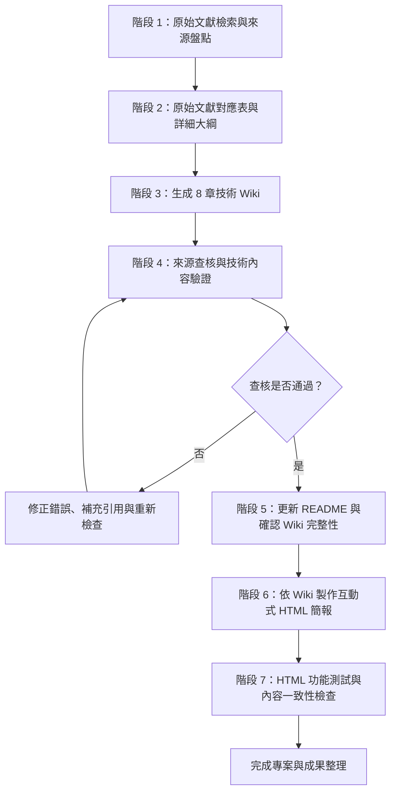

**# 自動駕駛技術知識百科 (Autonomous Driving Tech Wiki)**

**## 專案概述**

- **專案名稱**：自動駕駛技術知識百科
- **專案目標**：使用 LLM Wiki 建立具備學術與工程參考價值的自動駕駛技術知識庫，並以此知識庫為基礎，製作供初學者深入學習的互動式 HTML 教學簡報。

**---**

**## 專案核心執行規範 (Core Rules)**

1. **語系規範**：所有輸出內容、章節編撰、文件與說明均使用**繁體中文**（Traditional Chinese）。

2. **資料優先來源**：優先使用專案 `raw/` 資料夾中的 8 份原始文獻與技術報告作為主要資訊來源。

3. **學術與事實真實性**：嚴禁捏造、杜撰任何論文內容、作者資訊、實驗數據、測試指標或研究結論。引用研究數據時，必須保留原始實驗條件，不得將單一實驗結果當成所有設備的通用效能。

4. **來源追溯與出處標示**：每項重要技術資訊、數據及架構圖解說，應盡可能詳細標示**來源 PDF 檔名**與**對應頁碼**，包含 PDF 實體頁碼及原文件印刷頁碼。若原始文件沒有印刷頁碼，則標示 PDF 頁碼。

5. **專有名詞規範**：英文技術專有名詞應**保留原文**並附上**繁體中文解釋**，例如：`LiDAR（光達／光學雷達）`、`Dynamic Driving Task (DDT，動態駕駛任務)`。

6. **資訊層級區隔**：清楚區分以下三種資訊：
   - **文獻原始資料（Raw Data / Direct Fact）**：原始 PDF 明確記載的事實、數據與研究結果。
   - **AI 結構化整理內容（Structured Summary）**：根據原始文獻整理、歸納與解釋的內容。
   - **邏輯推論／產業衍生見解（Inference / Insight）**：根據技術原理延伸的推論或工程應用，不可冒充原始文獻的研究結論。

7. **初學者友善與圖表化**：撰寫需通俗易懂且循序漸進，適合初學者學習；適時搭配 Markdown 表格、Mermaid 流程圖、架構圖及分步技術解說。

8. **嚴謹邊界意識**：文獻資料不足或未提及之處，須明確加註「原始文獻未涵蓋此資訊」、「通用工程理論補充」或「待補充外部資料」，絕對不可自行補造事實、數據或引用頁碼。

9. **階段審查機制**：正式建立 Wiki 前，必須完成「原始文獻對應表」與「詳細章節大綱」的檢查與確認。Wiki 生成後，仍須進行來源查核、技術內容驗證與跨章節一致性檢查，確認後才能進入 HTML 簡報製作階段。

10. **單一事實來源（SSOT）**：製作後續互動式 HTML 教學簡報時，內容必須以已建立並完成查核的 Wiki 為依據，不得脫離 Wiki 內容妄加增刪或違背原意。若需要新增資料，應先更新 Wiki、補上來源並完成查核。

11. **文件一致性規範**：`README.md`、各章 Wiki 與本規範文件的章節名稱、來源資訊及專案進度必須保持一致。若內容有修改，應同步更新相關文件。

12. **修正與版本管理規範**：修改既有 Wiki 時，應保留原本章節架構、編號、重要圖表與必要公式；修正錯誤資訊時，應同步更新相關章節摘要與引用內容，不得只修改單一位置而造成內容矛盾。

**---**

**## 知識庫核心來源清單 (`raw/`)**

1. `LiDAR 光達.pdf`（*LiDAR odometry survey: recent advancements and remaining challenges* - Springer, Intelligent Service Robotics, 2024）
2. `SAE J3016.pdf`（*自動駕駛車輛道路測試規定之研議* - 交通部運輸研究所, 2019）
3. `YOLOP.pdf`（*YOLOP: You Only Look Once for Panoptic Driving Perception* - arXiv:2108.11250, 2021/2022）
4. `感測器融合.pdf`（*結合光達相機與雷達之追蹤演算法發展及其於自駕車之應用* - 國立成功大學碩士論文, 2019）
5. `自動緊急煞車性能評估.pdf`（*自動緊急煞車性能評估* - 財團法人車輛研究測試中心 ARTC, 2024）
6. `自駕車應用圖資選擇最佳行駛路徑.pdf`（*自駕車應用圖資選擇最佳行駛路徑* - 財團法人車輛研究測試中心 ARTC, 2022）
7. `自駕車暨先進駕駛輔助系統技術.pdf`（*自駕車暨先進駕駛輔助系統技術* - 工業技術研究院 ITRI, 2021）
8. `高精度地圖.pdf`（*Tutorial on High-Definition Map Generation for Automated Driving in Urban Environments* - MDPI Sensors, 2022）

**資料來源特別說明：**

- `SAE J3016.pdf` 實際內容為交通部運輸研究所的研究報告，報告引用 SAE J3016 分級概念，**並非 SAE 發布的 J3016 原始標準文件**。
- ARTC 的自動緊急煞車資料屬於技術資料，不應將其視為完整學術論文。
- ITRI 文件屬於技術簡介，應依照其實際內容引用，不可擴大解釋為完整實驗研究。

**---**

**## Wiki 規劃章節架構（共 8 章）**

- **第 1 章：自動駕駛基本原理與發展歷史**
- **第 2 章：SAE L0～L5 自動駕駛分級**
- **第 3 章：AI 人工智慧與 YOLO 影像辨識**
- **第 4 章：Camera 攝影機技術**
- **第 5 章：LiDAR 光達技術**
- **第 6 章：Radar 雷達技術與感測器融合**
- **第 7 章：路徑規劃自主決策與車輛控制**
- **第 8 章：自動煞車安全與未來應用**

**---**

**## 專案工作階段流程**

**---**

**## 專案執行與品質檢查原則**

1. **原始文獻查核**：確認每個章節的重要技術內容能對應到正確的原始 PDF。
2. **技術內容查核**：確認公式、演算法、設備規格及研究數據沒有錯誤。
3. **引用頁碼查核**：確認引用頁碼與實際文件內容一致，避免 PDF 頁碼與原始印刷頁碼混淆。
4. **跨章節一致性查核**：確認不同章節對相同技術名詞、演算法與系統架構的解釋一致。
5. **錯誤修正循環**：發現錯誤時，返回對應章節修正，再重新進行查核。
6. **HTML 內容驗證**：簡報內容必須與已查核 Wiki 一致，並測試導覽、按鈕、互動功能及頁面顯示。
7. **最終成果檢查**：確認 8 章 Wiki、README、HTML 簡報與相關說明文件完整。

**---**

**## 當前專案狀態**

- **原始資料準備**：已整理 `raw/` 資料夾中的 8 份 PDF。
- **規範文件**：已建立 `AGENTS.md`。
- **Wiki 章節**：已建立 8 章技術 Wiki，目前進行內容修正、來源查核與一致性檢查。
- **README.md**：已建立知識庫入口與 8 章目錄，依修正後內容同步更新。
- **HTML 教學簡報**：尚未開始製作。
- **目前工作重點**：完成 Wiki 最後查核，確認內容與來源一致，再開始製作互動式 HTML 教學簡報。

**---**

**## 最終專案目標**

完成一套以自動駕駛技術為主題的 LLM Wiki 知識庫，並以此為唯一內容依據，製作具有章節導覽、技術圖解、互動操作與初學者教學功能的 HTML 簡報，讓讀者能循序理解自動駕駛從環境感知、AI 決策到車輛控制的完整運作流程。
