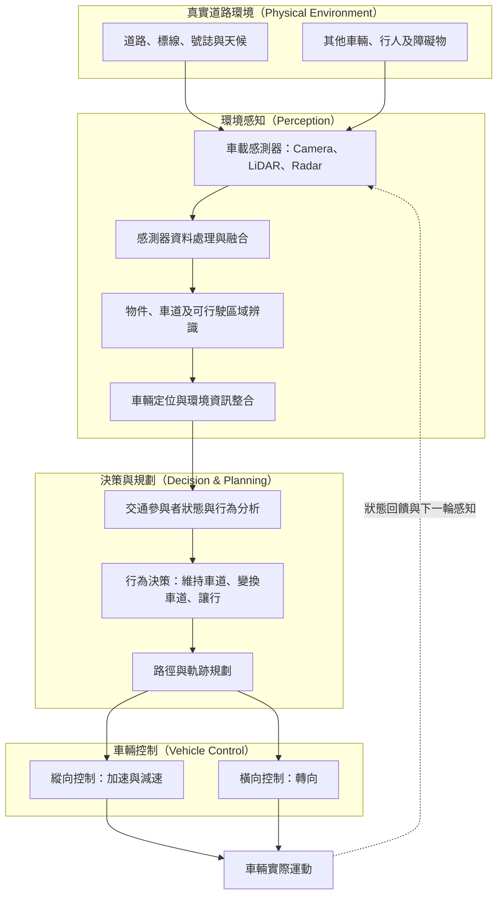

**# 第 1 章：自動駕駛基本原理與發展歷史**

**---**

**## 1. 本章學習目標**

* **掌握自動駕駛核心架構**：理解以「環境感知」、「決策規劃」及「車輛控制」為主軸的典型系統流程，以及感知結果如何回饋至後續控制。
* **理解虛實整合驗證**：認識實車道路測試與虛擬模擬測試的差異，以及兩者在自動駕駛系統驗證中的互補關係。
* **從事故案例理解安全議題**：了解自動駕駛測試事故所反映的感知、系統設計、人類監控及道路互動問題。
* **辨識歷史資料的範圍**：區分現有 8 份專案文獻實際記載的現代自駕發展內容，以及仍須另找資料補充的早期發展史。

**---**

**## 2. 章節簡介**

自動駕駛車輛（Automated Driving Vehicles）結合了人工智慧、感測器、車輛控制、機器人及交通工程等技術。它並不是單一的影像辨識程式，而是一套需要持續取得環境資訊、分析道路狀況、規劃行車行為，再控制車輛執行的整合系統。

典型自動駕駛系統可用「環境感知、決策規劃、車輛控制」三個主要階段來理解。實際系統可能再細分定位、地圖、預測、系統監控及故障處理等模組，並不一定只有三個軟體模組。

自動駕駛技術從研究測試走向道路應用的過程，也顯示安全驗證的重要性。除了在真實道路上累積測試經驗，開發團隊也會使用模擬環境測試不同交通情境。本章將介紹基本系統架構、現有文獻記載的發展案例，以及重大事故所帶來的安全啟示。

**---**

**## 3. 詳細技術小節**

**### 3.1 自動駕駛核心架構：感知、決策與控制**

自動駕駛系統可以用三個主要階段說明其運作流程。這是方便理解的概念性架構，實際車輛會依系統設計增加定位、地圖、預測、資料融合及安全監控等功能。專案中的工研院技術介紹資料可作為自駕車技術架構的入門參考 `[自駕車暨先進駕駛輔助系統技術.pdf，第 1 頁（PDF 第 1 頁）]`。

1. **環境感知層（Perception）**：
   * **職責**：透過車載感測器取得車輛周遭環境資訊，辨識道路、車輛、行人、交通號誌及其他物件。
   * **常見感測器**：攝影機（Camera）、光達（LiDAR）、雷達（Radar），以及依車輛設計使用的其他感測器。
   * **關鍵子任務**：
     * 目標物偵測（Object Detection）：找出影像或感測資料中的車輛、行人及障礙物。
     * 目標追蹤（Object Tracking）：持續追蹤物件的位置與移動狀態。
     * 車道與可行駛區域辨識（Lane / Drivable Area Detection）：分析車道線及車輛可行駛的道路區域。
     * 車輛定位（Localization）：估計車輛在道路或地圖中的位置與姿態。
2. **決策規劃層（Decision & Planning）**：
   * **職責**：整合感知、定位及地圖等資訊，決定車輛接下來應採取的行為與行駛路徑。
   * **關鍵子任務**：
     * 行為決策（Behavior Decision）：例如維持車道、變換車道、減速、停車及讓行。
     * 路徑規劃（Path Planning）：選擇車輛應行駛的路徑。
     * 軌跡規劃（Trajectory Planning）：依照道路與交通狀況，產生可供車輛控制器追蹤的行駛軌跡。
3. **車輛控制層（Vehicle Control）**：
   * **職責**：將規劃層產生的目標轉換為車輛可執行的控制命令。
   * **縱向控制（Longitudinal Control）**：控制車輛加速與減速，例如調整驅動輸出及煞車。
   * **橫向控制（Lateral Control）**：控制車輛轉向，使車輛沿規劃路徑行駛。
   * **回饋控制**：控制器會比較車輛目前狀態與目標狀態，持續修正控制命令，以降低速度或路徑偏差。

**補充：** 感知、決策與控制不是只執行一次的直線流程。車輛移動後，感測器會取得新的環境資料，系統再重新感知、規劃及控制，形成持續更新的閉迴路運作。

**### 3.2 現代自駕技術測試與虛實整合驗證**

自動駕駛系統需要面對多種道路、交通及環境條件。只依靠少量實車測試，難以涵蓋所有可能發生的情境；但只使用模擬器，也無法完全取代真實車輛與道路測試。因此，實車測試與虛擬模擬通常具有互補關係。

交通部運輸研究所的研究報告介紹了 Waymo 的自動駕駛測試發展與模擬驗證資訊 `[SAE J3016.pdf，印刷第 24、27～29 頁（PDF 第 34、37～39 頁）]`。

* **Waymo 公開道路測試**：
  * 交通部運輸研究所報告提及 Waymo 在美國亞利桑那州鳳凰城（Phoenix）進行自動駕駛道路測試的發展情形 `[SAE J3016.pdf，印刷第 24 頁（PDF 第 34 頁）]`。
  * 道路測試可讓開發團隊觀察系統在真實交通環境中的表現，例如道路使用者互動、交通號誌、道路施工及天候變化。
  * **注意**：測試地點、是否配置安全駕駛員、是否提供載客服務及當時核准的運行範圍，會隨時間與計畫階段改變。不能將某一時期的測試狀態直接當成目前所有 Waymo 車隊的狀態。
* **Carcraft 虛擬模擬平台**：
  * 研究報告也介紹 Waymo 使用模擬技術進行大量虛擬駕駛情境測試的作法 `[SAE J3016.pdf，印刷第 27～29 頁（PDF 第 37～39 頁）]`。
  * 模擬測試可建立不同道路、交通參與者及事件條件，讓工程師重複測試系統在特定情境中的反應。
  * **測試價值**：可針對較少出現、但值得特別驗證的情境進行測試，並比較不同軟體版本的結果。
  * **數據引用注意**：原章節所寫「每日 1,600 萬公里」屬於需要逐字核對原始報告的精確數值。本修正版不將此數字當成已確認事實；若要保留，請先核對該報告印刷第 27～29 頁的原文、單位及統計口徑。

**### 3.3 歷史事故與自動駕駛安全議題**

自動駕駛道路測試事故顯示，系統安全不只取決於單一感測器或辨識模型，也與系統整合、人類監控、車輛反應及道路環境有關。交通部運輸研究所報告對部分事故有簡要介紹 `[SAE J3016.pdf，印刷第 25～26 頁（PDF 第 35～36 頁）]`。

* **2018 年 Uber 坦佩市事故（Tempe, Arizona）**：
  * **事故經過**：2018 年 3 月，美國亞利桑那州坦佩市發生 Uber 自動駕駛測試車撞擊行人的致命事故。交通部運輸研究所報告以外電資料簡述事故及其後續測試影響 `[SAE J3016.pdf，印刷第 26 頁（PDF 第 36 頁）]`。
  * **資料界線**：交通部運輸研究所報告並未完整收錄美國國家運輸安全委員會（NTSB）的事故調查內容。因此，不能只依這份報告就斷言感知分類器如何跳變、追蹤資料是否重置、自動煞車系統如何設定，或安全員當時的具體行為。
  * **可延伸研究的安全議題**：
    1. **感知與追蹤可靠性**：系統必須穩定辨識及追蹤道路上的動態物件，避免短暫辨識錯誤造成後續判斷失準。
    2. **緊急應變設計**：系統應有清楚的風險判斷與緊急應變策略，並確認自動化功能之間不會產生安全缺口。
    3. **人類監控與接管**：若測試流程仍要求安全員監控，便必須考慮長時間監控造成的注意力下降，以及系統警示和接管安排是否適當。
  * **引用提醒**：若要深入介紹事故的技術肇因，應另外引用 NTSB 正式事故調查報告，不應把這些細節標示成交通部運輸研究所報告的內容。
* **Navya 自駕小巴拉斯維加斯碰撞事件**：
  * **事故經過**：交通部運輸研究所報告提及 Navya 自駕小巴在美國拉斯維加斯營運期間與貨車發生碰撞的事件 `[SAE J3016.pdf，印刷第 25～26 頁（PDF 第 35～36 頁）]`。
  * **技術觀察**：此類事件可用來討論自動駕駛車輛與其他道路使用者互動時的安全問題，包括低速行駛、障礙物偵測、停車策略及人類駕駛行為。
  * **資料界線**：不能只根據現有研究報告的簡短敘述，就推論小巴因缺乏按喇叭或倒車避讓功能而造成事故。若要分析事故責任及詳細經過，應查閱事件調查或主管機關資料。

**### 3.4 早期自動駕駛發展史（現有資料缺口）**

專案目前的 8 份 PDF 主要涵蓋自動駕駛分級、感測器、影像辨識、感測器融合、路徑規劃及安全應用，並不足以完整建立 1980 年代至 2000 年代的早期自駕發展時間軸。

以下主題可列為後續補充方向，但在取得並核對可靠來源之前，不將其寫成已由本專案 PDF 證實的歷史結論：

* **早期視覺導引研究**：可進一步查找歐洲車輛視覺導引研究、德國 PROMETHEUS 計畫及美國 Navlab 研究計畫的原始資料。
* **DARPA 無人車挑戰賽**：可查找 2004、2005 年 DARPA Grand Challenge，以及 2007 年 DARPA Urban Challenge 的官方資料，確認比賽規則、參賽隊伍與成果。
* **研究轉向商業應用**：可再補充 Google 自動駕駛計畫、Waymo 成立與道路測試發展的官方歷史資料。

**---**

**## 4. 核心技術名詞及繁體中文解釋**

| 英文專有名詞 | 縮寫 | 繁體中文名詞 | 核心定義與解釋 |
| :--- | :--- | :--- | :--- |
| **Automated Driving Vehicle** | ADV | 自動駕駛車輛 | 具備駕駛自動化功能，能在特定條件下執行部分或全部動態駕駛任務的車輛。 |
| **Perception** | - | 環境感知 | 利用感測器資料辨識道路環境、交通參與者及障礙物。 |
| **Decision & Planning** | - | 決策與規劃 | 根據環境資訊與車輛狀態，決定行車行為並產生路徑或軌跡。 |
| **Vehicle Control** | - | 車輛控制 | 將規劃結果轉換成轉向、加速及減速等車輛控制命令。 |
| **Closed-loop Control** | - | 閉迴路控制 | 依據車輛實際運動結果回饋並修正控制命令的控制方式。 |
| **Virtual Simulation** | - | 虛擬模擬測試 | 在電腦建立的模擬環境中測試系統，重複驗證不同道路與交通情境。 |
| **Edge Case** | - | 邊界情境 | 發生頻率可能較低，但對系統判斷或安全性具有挑戰性的特殊情境。 |
| **Driver Monitoring System** | DMS | 駕駛員監控系統 | 監控駕駛人的注意力或操作狀態，常見方式包括使用車內攝影機。 |
| **Drive-by-Wire** | DbW | 線控系統 | 透過電子訊號控制車輛轉向、驅動或煞車等功能的技術架構。 |

**---**

**## 5. 重要原理與技術運作流程**

自動駕駛的基本運作可表示為「環境感知 → 決策規劃 → 車輛控制 → 車輛運動回饋」的循環。以下 Mermaid 圖為概念示意，實際系統的模組順序與資料流會依架構而有所不同。

**流程說明：**

1. **取得環境資料**：攝影機、光達及雷達等感測器取得道路與周遭物件資訊。
2. **辨識與定位**：系統處理感測資料，辨識交通參與者、道路區域並估計車輛位置。
3. **分析與規劃**：系統根據目前環境及預測結果，選擇行車行為並產生路徑或軌跡。
4. **執行車輛控制**：控制器將目標轉換成轉向、加速及減速命令。
5. **回饋更新**：車輛產生新的運動狀態，感測器取得更新資料，系統再進行下一輪運算。

**---**

**## 6. 實際應用案例**

**### 6.1 Waymo 自動駕駛道路測試**

* **運行方式**：Waymo 在美國部分地區進行自動駕駛道路測試與服務。其可運行範圍及是否配置安全駕駛員，會依地區、服務階段及主管機關核准條件而不同。
* **技術依託**：自動駕駛系統需要整合感測器、定位、環境辨識、決策規劃及車輛控制等技術。
* **資料來源界線**：交通部運輸研究所報告記載的是特定時期的發展資訊 `[SAE J3016.pdf，印刷第 24 頁（PDF 第 34 頁）]`，不能直接當成 Waymo 現在所有營運區域的最新狀況。

**### 6.2 虛實整合測試流程**

* **實車測試**：在真實道路或封閉測試場域收集感測器資料，觀察系統面對真實交通環境時的表現。
* **模擬測試**：將具代表性的道路情境建立於模擬環境中，測試不同交通參與者位置、車速或事件條件。
* **結果驗證**：比較系統在不同測試情境中的辨識、規劃及控制表現，找出需要改善的部分。
* **反覆修正**：更新演算法或系統設定後，再透過模擬與實車測試確認改善效果。模擬測試可提高情境重複測試的效率，但不能完全取代真實道路驗證。

**---**

**## 7. 優點、缺點與技術限制**

| 評估面向 | 實車道路／封閉場地測試 | 虛擬模擬測試 |
| :--- | :--- | :--- |
| **主要優點** | 1. 可觀察真實道路與交通參與者互動。 2. 能測試實際感測器、車輛硬體及控制系統。 3. 可發現模擬環境不一定能完整呈現的問題。 | 1. 可重複建立特定測試情境。 2. 可測試較難在真實道路安全重現的特殊事件。 3. 便於比較不同軟體版本在相同情境中的表現。 |
| **主要缺點與限制** | 1. 測試成本與時間可能較高。 2. 特殊或危險情境不適合在真實道路任意重複。 3. 交通與天候具有變動性，不易完全重現相同條件。 | 1. 模擬結果受環境模型、感測器模型及物理引擎準確度影響。 2. 模擬環境與真實世界可能存在差異（Sim-to-Real Gap）。 3. 不能單獨取代實車硬體、道路及法規要求的驗證。 |

**---**

**## 8. 圖解建議**

1. **三層自動駕駛架構圖**：依序呈現環境感知、決策規劃與車輛控制，並以回饋箭頭表示車輛運動後會取得新資料，再進行下一輪運算。
2. **虛實整合驗證流程圖**：呈現實車測試、資料整理、模擬情境建立、軟體測試、結果分析及再次實車驗證的循環。
3. **事故安全議題分析圖**：以 Uber 坦佩市事故為例，分別列出感知系統、人類監控、系統應變及測試安全等需要查證的面向；在取得 NTSB 原始調查資料前，不繪製未經證實的單一路徑因果鏈。

**---**

**## 9. 專有名詞彙整表**

| 名詞 | 英文全名 | 中文解釋 |
| :--- | :--- | :--- |
| **ODD** | Operational Design Domain | 設計運行領域，指自動駕駛系統被設計為能夠運作的特定條件範圍。 |
| **DMS** | Driver Monitoring System | 駕駛員監控系統，用於監控駕駛人的注意力或操作狀態。 |
| **Closed-loop Control** | Closed-loop Control | 閉迴路控制，利用系統輸出或車輛狀態的回饋修正控制命令。 |
| **Sim-to-Real Gap** | Simulation-to-Reality Gap | 模擬與真實世界之間的差異，可能來自感測器、環境模型或物理模擬不完全相同。 |
| **Drive-by-Wire** | Drive-by-Wire | 線控技術，透過電子訊號控制車輛的轉向、驅動或煞車等功能。 |
| **Edge Case** | Edge Case | 邊界情境，指較少見但可能對自動駕駛系統造成挑戰的特殊情況。 |

**---**

**## 10. 本章重點整理**

1. 自動駕駛系統可用 **環境感知、決策規劃及車輛控制** 三個主要階段理解；實際系統還可能包含定位、地圖、預測、資料融合及安全監控等模組。
2. 自動駕駛的運作不是單向流程，而是透過車輛狀態回饋持續更新環境資訊、規劃及控制，形成閉迴路。
3. **實車測試與虛擬模擬具有互補性**：實車測試可觀察真實環境與硬體表現，模擬測試則可重複建立特定情境；兩者都不能完全取代對方。
4. Uber 坦佩市與 Navya 小巴事故提醒自駕系統開發者，必須重視感知可靠性、系統應變、人類監控及與其他道路使用者的互動。
5. 現有專案文獻不足以完整支持 1980 年代至 DARPA 挑戰賽的早期發展時間軸；相關歷史應另找官方或學術來源補充，不應將待查證內容當成已驗證事實。

**---**

**## 參考資料**

1. 工業技術研究院（ITRI），《自駕車暨先進駕駛輔助系統技術》，技術介紹資料，2021。此資料為自駕車技術介紹，並非學術論文。
2. 交通部運輸研究所，張開國、葉祖宏、賴靜慧、洪憲忠，《自動駕駛車輛道路測試規定之研議》，2019 年 7 月。此研究報告包含自動駕駛分級、道路測試及相關案例介紹。
3. 若要補充 Uber 坦佩市事故的詳細技術肇因，應另引用美國國家運輸安全委員會（NTSB）的正式事故調查報告。
4. 若要補充 PROMETHEUS、Navlab、DARPA Grand Challenge 與 DARPA Urban Challenge 等早期發展史，應另加入相應計畫的官方資料或原始研究文獻。

**---**

**## 資料來源與引用範圍說明**

* 本章引用的交通部運輸研究所報告，檔案名稱為 `SAE J3016.pdf`，但該 PDF 實際文件是《自動駕駛車輛道路測試規定之研議》，不是 SAE J3016 原始標準。
* 工研院《自駕車暨先進駕駛輔助系統技術》為技術介紹資料，適合作為入門背景，不應描述成學術實驗論文。
* Waymo 測試與模擬平台的描述，應以研究報告當時記載的內容為限；若要保留精確模擬里程、測試日期或目前營運狀態，必須再核對原文或最新官方資料。
* Uber 與 Navya 事故在本章僅作為安全議題案例。未由現有 PDF 證實的事故肇因、系統內部設定及法律責任，不列為已確認事實。
