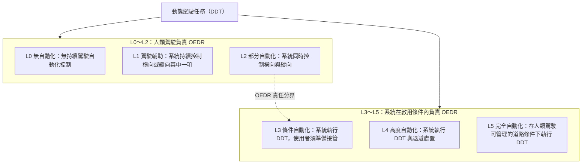

**# 第 2 章：SAE L0～L5 自動駕駛分級**

**---**

**## 1. 本章學習目標**

* **精準掌握自動化分級維度**：理解動態駕駛任務（DDT）、物件與事件偵測及反應（OEDR）、DDT 退避處置（DDT Fallback）及設計運行領域（ODD）等核心概念。
* **逐級掌握 L0 至 L5 技術特徵**：理解不同等級下，系統與人類駕駛在車輛控制、環境監控及失效處置上的分工。
* **釐清 L2 與 L3 的技術差異**：掌握 L2 由人類駕駛負責 OEDR，而 L3 在系統啟動且處於 ODD 內時由自動駕駛系統執行 DDT 與 OEDR 的差異。
* **辨認資料來源性質**：了解本章主要中文資料是交通部運輸研究所的研究報告；該報告討論及引用 SAE J3016，並非 SAE 發布的原始標準文件。

**---**

**## 2. 章節簡介**

「自動駕駛」並不是單一功能，也不能只依照車輛是否能自行轉動方向盤或控制速度來判斷。為了讓產業、研究人員及主管機關有一致的技術分類方式，國際汽車工程師學會（SAE International）制定了 SAE J3016《Taxonomy and Definitions for Terms Related to Driving Automation Systems》，用來分類道路車輛的駕駛自動化系統。

本章使用的主要中文資料為交通部運輸研究所 2019 年研究報告《自動駕駛車輛道路測試規定之研議》。這份報告整理並討論 SAE J3016 的分級概念，但它本身不是 SAE J3016 原始標準文件。報告中的 L0～L5 分級表與 ODD 說明，可作為理解自動化分級的中文參考資料 `[SAE J3016.pdf，印刷第 8～13 頁（PDF 第 18～23 頁）]`。

本章將從 DDT、OEDR、DDT Fallback 與 ODD 四個概念出發，說明 L0 至 L5 的差異，並特別釐清 L2 與 L3 在環境監控責任上的不同。需要注意的是，SAE 分級主要描述駕駛自動化系統的功能與任務分配，不能直接等同於各國事故責任或法律責任的判定。

**---**

**## 3. 詳細技術小節**

**### 3.1 SAE J3016 四大核心技術維度**

SAE J3016 的分級不是依據感測器數量、車輛價格或品牌，而是依據系統在動態駕駛任務、環境監控、失效退避及運行條件等方面的分工。交通部運輸研究所報告整理了相關概念 `[SAE J3016.pdf，印刷第 8～13 頁（PDF 第 18～23 頁）]`。

1. **動態駕駛任務（DDT, Dynamic Driving Task）**：
   * 指車輛在道路上行駛時所需執行的即時駕駛操作與戰術性決策。
   * **操作性控制（Operational）**：例如轉向、加速及減速等即時車輛控制。
   * **戰術性控制（Tactical）**：例如依交通情況進行車道變換、超車、轉彎及讓行等行車決策。
   * **不包含的事項**：選擇目的地、決定整趟旅程的導航路線等戰略性活動，不屬於 DDT。
2. **物件與事件偵測及反應（OEDR, Object and Event Detection and Response）**：
   * 指監控道路環境、辨識可能影響駕駛的物件與事件，並作出適當反應的能力。
   * 例如辨識其他車輛、行人、交通號誌、道路障礙物，以及對其採取減速、煞車或轉向等反應。
3. **DDT 退避處置（DDT Fallback）**：

   * 指自動駕駛系統無法繼續執行 DDT 時，負責接續處理駕駛任務或使車輛進入適當風險狀態的安排。

   * L0～L2 由人類駕駛負責必要的退避處置；L3 則由備援接管使用者（Fallback-ready User）在系統提出接管請求後接手；L4 與 L5 則由自動駕駛系統負責相應的退避處置。

   * 退避處置可能使車輛進入最小風險條件（MRC, Minimal Risk Condition）。實際操作方式會依系統設計、道路環境及車輛狀況而不同，不代表一定要停在路肩。
4. **設計運行領域（ODD, Operational Design Domain）**：
   * 指自動駕駛系統被設計為能夠執行 DDT 的特定運行條件範圍。
   * 條件可包含道路類型、地理區域、車速範圍、天候、光照及其他環境限制。
   * 例如某系統可能只在特定道路、指定速度範圍及符合特定天候條件時才能啟用。報告以圖示說明 ODD 的概念 `[SAE J3016.pdf，印刷第 13 頁（PDF 第 23 頁，圖 2.1）]`。
   * ODD 是依個別系統設計而定，不能把某一車款或某一系統的速度、天候限制套用到所有自動駕駛系統。

**---**

**### 3.2 L0～L5 自動化等級逐級深度解構**

交通部運輸研究所報告整理的 L0～L5 分級，主要依據系統是否持續執行橫向與縱向控制，以及由誰負責 OEDR 和 DDT Fallback 來區分 `[SAE J3016.pdf，印刷第 8～12 頁（PDF 第 18～22 頁，表 2-1、表 2-2）]`。

**#### 3.2.1 L0（No Driving Automation，無自動化）**

* **控制主體**：人類駕駛負責持續的橫向與縱向車輛控制。
* **系統功能**：系統可能提供警告，或在必要時短暫介入，但不會持續執行橫向或縱向駕駛控制。
* **典型功能**：前向碰撞警示（FCW）、車道偏離警示（LDW），以及符合 L0 定義的短暫介入功能。自動緊急煞車（AEB）可能屬於此類，但仍須依系統實際功能與定義判斷。
* **駕駛職責**：駕駛人持續負責 DDT、OEDR 及必要的退避處置。
* **注意事項**：不能把「AEB 一定只在碰撞前 1 秒內介入」當成 SAE L0 的通用定義；實際啟動時機取決於系統設計與測試條件。

**#### 3.2.2 L1（Driver Assistance，駕駛輔助）**

* **控制主體**：系統持續執行橫向控制或縱向控制其中一項，另一項由人類駕駛負責。
* **典型功能**：
  * 主動車距控制巡航（ACC）：系統控制車速或與前車的距離，人類駕駛仍負責轉向。
  * 車道維持輔助（LKA）：系統提供持續的橫向轉向控制，人類駕駛仍負責縱向控制。
* **駕駛職責**：人類駕駛仍負責 OEDR，並持續監控道路環境及執行未由系統負責的駕駛任務。

**#### 3.2.3 L2（Partial Driving Automation，部分自動化）**

* **控制主體**：系統在啟用條件內，同時執行橫向與縱向車輛控制。
* **典型功能**：同時具備車道居中或轉向控制，以及 ACC 車速與車距控制的駕駛輔助系統。
* **駕駛職責**：**OEDR 仍由人類駕駛負責。** 駕駛人必須持續監控道路與交通狀況，並準備隨時介入。
* **注意事項**：L2 並不代表車輛可以自行完成所有駕駛任務。即使系統同時控制方向與速度，駕駛人仍不能把注意力完全交給系統。

**#### 3.2.4 L3（Conditional Driving Automation，條件自動化）**

* **控制主體**：在系統啟用且符合 ODD 的條件下，系統持續執行完整 DDT，包括橫向與縱向控制及 OEDR。
* **人類角色**：人類使用者是**備援接管使用者（Fallback-ready User）**，必須在系統提出接管請求或發生相關狀況時，具備接手駕駛的準備。
* **接管機制**：當系統即將無法繼續執行 DDT 時，可能發出接管請求（TOR, Takeover Request），要求使用者接手。
* **重要限制**：SAE 分級本身沒有規定所有 L3 系統都必須給予固定的 5～10 秒接管時間。接管時間與警示方式會受到系統設計、運行條件及適用規範影響。
* **注意事項**：L3 並不代表使用者可以在任何情況下任意分心，也不代表所有國家或地區都允許相同的非駕駛活動。

**#### 3.2.5 L4（High Driving Automation，高度自動化）**

* **控制主體**：在系統設計的 ODD 內，系統負責執行完整 DDT，包括 OEDR。
* **Fallback 機制**：當系統無法繼續執行 DDT 時，系統必須能在其設計條件內完成退避處置，不以人類使用者及時接管作為必要前提。
* **運行範圍**：L4 仍有 ODD 限制，例如特定地理區域、道路類型或運行條件。
* **注意事項**：是否配置方向盤、油門或煞車踏板，並不是判斷 L4 的唯一標準；重點是系統是否能在 ODD 內完成 DDT 與必要的退避處置。

**#### 3.2.6 L5（Full Driving Automation，完全自動化）**

* **控制主體**：系統能在不受特定 ODD 限制的條件下，執行完整 DDT。
* **運行範圍**：L5 的設計能力應涵蓋人類駕駛者通常能夠管理的道路與環境條件，而不是只適用於特定地理圍欄或限定路線。
* **重要限制**：L5 不應被簡化成「任何天候、任何地形、任何極端環境都能行駛」。SAE 分級中的完全自動化，仍是以人類駕駛者可管理的道路與環境條件作為理解基礎。

**---**

**### 3.3 L2 與 L3 的 OEDR 責任分界與人機接管問題**

L2 與 L3 最重要的技術差異，不是系統能不能同時控制方向盤與油門煞車，而是**誰負責 OEDR（物件與事件偵測及反應）**。交通部運輸研究所報告的分級表可用來對照不同等級的任務分配 `[SAE J3016.pdf，印刷第 8～12 頁（PDF 第 18～22 頁，表 2-1、表 2-2）]`。

1. **L2：人類駕駛負責 OEDR**
   * 系統可以同時控制車輛的橫向與縱向運動，但人類駕駛仍須持續監控道路環境。
   * 駕駛人需要辨識系統未能妥善處理的狀況，並在必要時介入。
2. **L3：系統在啟用條件內負責 OEDR**
   * 在符合 ODD 且系統正常執行的期間，系統負責 DDT 與 OEDR。
   * 使用者不再需要像 L2 駕駛人一樣持續執行道路環境監控，但必須依系統要求保持接管準備。
3. **人機接管的工程挑戰**
   * 當系統提出 TOR 時，使用者需要重新理解道路環境、判斷周遭車輛與障礙物的位置，再接手控制。
   * 接管安全性會受到警示時間、駕駛人當時活動、道路情況、車速及系統提供的資訊影響。
   * 例如車速為 100 km/h 時，車輛每秒約行駛 27.8 公尺；若反應延遲 5 秒，車輛約行駛 139 公尺。這是單純的距離換算示例，並非 SAE J3016 規定的接管時間，也不能直接用來判定某系統是否安全。

**重要觀念：** SAE 自動化等級描述的是系統功能及駕駛任務分配，不是事故法律責任的直接判定表。事故責任仍須依事故原因、產品責任、駕駛行為及當地法律等因素判斷。

**---**

**## 4. 核心技術名詞及繁體中文解釋**

| 英文專有名詞 | 縮寫 | 繁體中文名詞 | 核心定義與解釋 |
| :--- | :--- | :--- | :--- |
| **Dynamic Driving Task** | DDT | 動態駕駛任務 | 車輛行駛時所需的即時操作與戰術性駕駛功能，例如轉向、加減速、變換車道及讓行。 |
| **Operational Design Domain** | ODD | 設計運行領域 | 自動駕駛系統被設計為能夠執行 DDT 的特定運行條件範圍。 |
| **Object and Event Detection and Response** | OEDR | 物件與事件偵測及反應 | 監控道路環境、辨識物件與事件，並作出適當駕駛反應的能力。 |
| **DDT Fallback** | - | 動態駕駛任務退避處置 | 系統無法繼續執行 DDT 時，負責接續處理或完成退避任務的安排。 |
| **Minimal Risk Condition** | MRC | 最小風險條件 | 自動駕駛系統透過退避處置，使車輛達到相對較低風險的運行條件。 |
| **Minimal Risk State** | MRS | 最小風險狀態 | 部分技術資料使用的相關描述，使用時應依照所引用文件的術語定義，不宜直接與 SAE 的 MRC 視為完全相同的標準術語。 |
| **Takeover Request** | TOR | 接管請求 | L3 系統要求備援接管使用者接手 DDT 時所發出的請求。 |
| **Fallback-ready User** | - | 備援接管使用者 | 在 L3 自動化系統運行期間，必須具備於系統要求時接手駕駛任務能力的使用者。 |

**---**

**## 5. 重要原理與技術比較**

**### SAE J3016 L0～L5 駕駛任務權責分配矩陣**

下表依據交通部運輸研究所報告所整理的 SAE 自動化分級概念改寫 `[SAE J3016.pdf，印刷第 8～12 頁（PDF 第 18～22 頁，表 2-1、表 2-2）]`。表中的「人類」與「系統」代表任務執行者，不代表事故法律責任的自動歸屬。

| 自動化等級 | 名稱 | 橫向與縱向車輛控制 | 周遭環境監控（OEDR） | DDT 退避處置（Fallback） | ODD |
| :---: | :--- | :--- | :--- | :--- | :--- |
| **L0** | 無自動化 | 人類駕駛 | 人類駕駛 | 人類駕駛 | 不以自動化系統 ODD 分級 |
| **L1** | 駕駛輔助 | 系統持續控制橫向或縱向其中一項；另一項由人類控制 | 人類駕駛 | 人類駕駛 | 依輔助功能及系統條件而定 |
| **L2** | 部分自動化 | 系統同時控制橫向與縱向 | **人類駕駛** | **人類駕駛** | 受系統啟用條件限制 |
| **L3** | 條件自動化 | 系統執行完整 DDT | **系統** | 系統提出接管請求後，由備援接管使用者接手 | 受限 |
| **L4** | 高度自動化 | 系統執行完整 DDT | 系統 | **系統在其 ODD 內完成退避處置** | 受限 |
| **L5** | 完全自動化 | 系統執行完整 DDT | 系統 | 系統負責相應的 DDT 退避處置 | 不受特定 ODD 限制，設計能力涵蓋人類駕駛者可管理的道路與環境條件 |

**補充說明：**
* L0～L2 的駕駛人負責 OEDR；L3～L5 則由自動駕駛系統在啟用條件內負責 OEDR。
* L3 與 L4 的重要差異之一，是系統無法繼續執行 DDT 時，是否仍需要依賴人類使用者接手。
* 「事故法律主體」不宜直接放進 SAE 分級矩陣，因為 SAE 技術分級本身不決定各國法律上的事故責任。

**---**

**## 6. 實際應用案例**

**### 6.1 L2 駕駛輔助系統的判讀方式**

* **功能組合**：若一套系統能同時持續控制車輛橫向與縱向運動，例如車道居中加上 ACC，且仍要求駕駛人持續監控道路環境，便符合 L2 的核心任務分配特徵。
* **判讀重點**：不能只因系統具有自動換道、辨識號誌或其他進階功能，就直接判定其為 L3 或更高等級。仍須確認系統是否負責 OEDR，以及其實際設計與啟用條件。
* **使用提醒**：L2 駕駛人必須持續注意道路，不能把駕駛任務完全交給系統。

**### 6.2 L3 系統的判讀方式**

* **功能組合**：L3 系統在符合 ODD 且啟用時，負責完整 DDT 與 OEDR；使用者則擔任備援接管角色。
* **接管安排**：當系統無法繼續執行 DDT 時，會依設計提出接管請求，要求使用者接手。
* **判讀重點**：不能只根據車廠宣傳中的「自動駕駛」名稱或單一功能來認定等級，必須檢視其正式功能定義、ODD、OEDR 責任及退避設計。
* **資料界線**：本章使用的交通部運輸研究所報告可作為 SAE 分級與道路測試規範的中文背景資料；若要介紹特定車款目前在哪些國家、道路或速度條件下獲准使用，必須另外查核該車廠及主管機關的最新公告，不能以本研究報告中的一般分級內容代替。

**---**

**## 7. 優點、缺點與技術限制**

| 分級類別 | 核心優點 | 主要缺點與技術限制 |
| :--- | :--- | :--- |
| **L0～L1 警示與單項輔助** | 可提供警示或部分車輛控制，協助駕駛人處理特定駕駛工作。 | 駕駛人仍須負責完整的道路環境監控與其他駕駛任務；功能效果受感測器、道路及環境條件影響。 |
| **L2 部分自動化** | 系統可同時控制橫向與縱向運動，減少部分重複性的操作工作。 | OEDR 仍由人類駕駛負責；若駕駛人誤以為系統能完全自主駕駛，可能產生過度信任或注意力不足的風險。 |
| **L3 條件自動化** | 系統在 ODD 內負責 DDT 與 OEDR，減少使用者持續監控道路的需求。 | 系統提出接管請求時，使用者仍須具備接手能力；接管時間、警示設計及人機互動是重要工程挑戰。 |
| **L4 高度自動化** | 系統可在特定 ODD 內執行完整 DDT，並自行完成必要的退避處置，不以人類及時接管作為必要條件。 | 系統能力受 ODD 限制；要在指定道路與環境中可靠運作，需要完整的感知、決策、控制及故障處理設計。 |
| **L5 完全自動化** | 目標是在不受特定 ODD 限制的條件下，執行人類駕駛者可管理範圍內的完整 DDT。 | 需要處理廣泛的道路、交通、天候與突發情境，技術驗證與安全保證難度極高。 |

**---**

**## 8. 圖解建議**

1. **SAE J3016 分級階梯圖**：以 L0 至 L5 作為六個階段，呈現自動化程度逐步提高的概念。可在 L2 與 L3 之間標示「OEDR 責任由人類轉為系統」的技術分界；避免將此線直接標示為法律責任分界。
2. **ODD 多維條件概念圖**：以道路類型、地理區域、車速、天候及光照等條件呈現某套自動駕駛系統的可運行範圍。當運行條件超出該系統 ODD 時，系統必須依其自動化等級及設計執行相應處置 `[參考 SAE J3016.pdf，印刷第 13 頁（PDF 第 23 頁，圖 2.1）]`。
3. **L2 與 L3 人機分工圖**：分別畫出 L2 的「系統控制車輛、駕駛人監控環境」及 L3 的「系統控制車輛並監控環境、使用者準備接管」，幫助讀者理解兩者差異。

**---**

**## 9. 專有名詞彙整表**

| 名詞 | 英文全名 | 中文解釋 |
| :--- | :--- | :--- |
| **SAE J3016** | Taxonomy and Definitions for Terms Related to Driving Automation Systems | SAE 國際汽車工程師學會發布的道路車輛駕駛自動化系統分類與術語定義標準。 |
| **Operational Control** | Operational Control | 操作性控制，包含轉向、加速及減速等即時車輛控制。 |
| **Tactical Control** | Tactical Control | 戰術性控制，包含變換車道、超車、讓行及處理交通情況等駕駛決策。 |
| **Fallback-ready User** | Fallback-ready User | 備援接管使用者，指 L3 系統運行期間，必須準備在系統提出要求時接手駕駛任務的人。 |
| **Takeover Request** | Takeover Request | 接管請求，系統要求備援接管使用者接手駕駛任務時發出的通知或請求。 |
| **Minimal Risk Condition** | Minimal Risk Condition | 最小風險條件，指自動駕駛系統透過退避處置，使車輛達到相對較低風險的運行條件。 |

**---**

**## 10. 本章重點整理**

1. SAE J3016 的自動化分級，重點在於 **DDT（動態駕駛任務）、OEDR（物件與事件偵測及反應）、DDT Fallback（退避處置）與 ODD（設計運行領域）** 等概念及其任務分配。
2. **L2 與 L3 的核心技術分界是 OEDR 的負責者**：L2 由人類駕駛負責環境監控；L3 則由系統在啟用且符合 ODD 的期間負責 DDT 與 OEDR，使用者仍須準備接管。
3. **L4 的系統必須能在其 ODD 內自行完成必要的 DDT 退避處置**，不以人類使用者及時接管作為必要前提。
4. **L5 不受特定 ODD 限制**，但不應誤解為能在任何極端天候或所有地形下無條件行駛。
5. SAE 自動化等級是技術分類，**不能直接當作事故法律責任判定表**。實際責任仍須依事故事實與適用法律判斷。

**---**

**## 參考資料**

1. 交通部運輸研究所，張開國、葉祖宏、賴靜慧、洪憲忠，《自動駕駛車輛道路測試規定之研議》，2019 年 7 月。此文件為本章主要中文參考資料，內容討論 SAE J3016 分級；**不是 SAE J3016 原始標準文件**。
2. SAE International, *Taxonomy and Definitions for Terms Related to Driving Automation Systems for On-Road Motor Vehicles (J3016)*. 本章分級概念所依據的標準名稱；若需逐字引用標準條文，應另行取得並核對相應版本。
3. 陳威廷，《結合光達相機與雷達之追蹤演算法發展及其於自駕車之應用》，國立成功大學電機工程學系碩士論文，2019 年 7 月。作為自動駕駛系統與感測器應用的補充參考。

**---**

**## 資料來源與引用範圍說明**

* 本章主要分級表與 ODD 圖示引用交通部運輸研究所研究報告，引用格式為 `[SAE J3016.pdf，印刷第 P 頁（PDF 第 X 頁）]`。
* 檔名 `SAE J3016.pdf` 是專案中原始 PDF 的檔名，**不代表該 PDF 就是 SAE 發布的原始標準**。
* 關於 L2/L3 法律責任、固定 TOR 秒數、特定車款的最新核准範圍及事故案例，本章不以該研究報告推導結論；若要加入，應另找對應國家或主管機關的法規、公告或事故調查資料。
