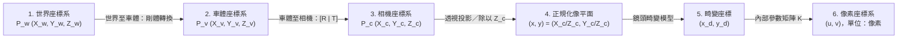
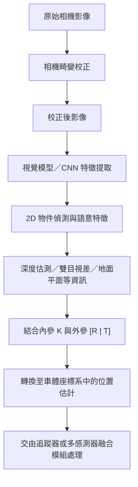

**# 第 4 章：Camera 攝影機技術**

**---**

**## 1. 本章學習目標**

* **掌握車載相機成像幾何原理**：理解小孔成像模型（Pinhole Camera Model），掌握三維世界座標、車體座標、相機座標與二維像素座標之間的幾何轉換。
* **理解相機內外參數標定原理**：依據國立成功大學碩士論文中座標系與尤拉角旋轉矩陣的說明 `[感測器融合.pdf，印刷第 16～17 頁（PDF 第 30～31 頁，公式 2.1 至 2.5）]`，認識外部參數剛體轉換矩陣 `[R | T]`；並以通用多視角幾何理論補充內部參數矩陣 `K` 與透鏡畸變模型。
* **認識車載相機硬體與配置**：了解車載攝影機在影像解析度、動態範圍、視野（FOV）及鏡頭配置上的設計考量。原始 ITRI 技術介紹可作為車載視覺應用背景資料 `[自駕車暨先進駕駛輔助系統技術.pdf，第 2～3 頁（PDF 第 2～3 頁）]`；特定數值規格若未由原始文件明確提供，不列為該文件的研究結果。
* **辨識相機的物理限制**：分析逆光眩光（Glare）、隧道進出時的明暗變化、雨滴或污漬遮蔽，以及單目相機缺乏直接絕對深度量測能力等工程限制。

**---**

**## 2. 章節簡介**

在自動駕駛的多感測器系統中，攝影機（Camera）能提供高解析度的色彩、紋理與影像資訊，適合用於辨識紅綠燈、交通標誌、車道線及道路場景中的物體。

然而，單一攝影機主要是將三維世界投影至二維影像平面。投影過程會使深度資訊無法直接從單張影像的像素座標中唯一確定。因此，系統需要透過相機成像模型、相機標定（Camera Calibration），以及其他感測器或視覺演算法，推估物體在真實世界中的位置與距離。

本章介紹針孔相機模型、內外參數、透鏡畸變與相機配置，並說明攝影機在自動駕駛中的優勢與限制。數學模型及標定方法屬於通用工程理論補充，並非全部都直接出自本章列出的原始 PDF。

**---**

**## 3. 詳細技術小節**

**### 3.1 車載攝影機物理特性與感測機制**

車載攝影機需要在日照、夜間、隧道、雨霧及車輛震動等環境下工作。與一般室內攝影不同，車載影像系統必須考慮光照變化、鏡頭污染、視野覆蓋及影像處理延遲等因素。原始感測器融合論文中的表 2.1 可用來比較攝影機、雷達與光達的感測特性 `[感測器融合.pdf，印刷第 7～9 頁（PDF 第 21～23 頁，表 2.1）]`。

1. **高動態範圍（HDR, High Dynamic Range）**：
   * 車輛可能在短時間內由明亮戶外進入昏暗隧道，或面對夕陽及車燈等強光來源。相機需要盡可能保留亮部與暗部細節，降低過曝或欠曝造成的辨識困難。
   * ITRI 技術介紹可作為自駕系統影像處理需求的背景資料；但「車規級相機通常要求大於 120 dB」並非目前列出的原始文件已確認之數值，因此本章不將此數值寫成文件結論。若要保留，應另補具體相機規格書或標準來源。

2. **多相機配置與視野覆蓋（FOV, Field of View）**：
   * **前向相機（Forward-facing Camera）**：安裝於車輛前方，提供前方道路、車道線、交通標誌及其他道路使用者的影像。
   * **廣角相機（Wide-angle Camera）**：以較大的水平視野涵蓋車輛前方兩側區域，但影像邊緣可能有較明顯的透視變形或鏡頭畸變。
   * **環景魚眼相機（Surround-view Fisheye Camera）**：可配置於車輛前、後及側面，以廣角影像協助低速環景檢視與停車輔助。實際鏡頭數量、安裝位置及視角會依車型與系統設計而不同。
   * **雙目立體相機（Stereo Vision）**：使用兩台具有固定相對位置的相機，利用左右影像之間的視差（Disparity）估計場景深度。估測品質會受到基線長度、影像解析度、場景紋理及標定品質影響。

> **資料界線：** 本章原始資料可支持車載視覺與感測器特性的基本介紹；原文所列的 30°、100°～120°、180°～195°、150～250 公尺等特定數值，尚未能由目前已知的來源資訊確認，故不列為已驗證規格。

**---**

**### 3.2 針孔相機幾何投影模型（Pinhole Camera Model）**

針孔相機模型以簡化的幾何方式描述三維空間點如何投影到二維影像平面。實際系統可依序考慮世界座標、車體座標、相機座標、正規化像平面座標、畸變後座標及像素座標。以下為通用工程理論補充。不同座標系之間的轉換方式，須依照各系統定義的座標軸方向、原點位置及旋轉順序建立，不能直接假設所有車載系統都採用相同座標慣例。

1. **世界座標系（World Coordinate Frame）**：用來描述物體在全域參考座標中的位置，例如地圖或場景所採用的座標系。
2. **車體座標系（Vehicle Coordinate Frame）**：固定於車輛本體，常用來描述物體相對於車輛的位置。座標軸方向須依系統定義。
3. **相機座標系（Camera Coordinate Frame）**：原點位於相機光學中心，座標軸方向依相機模型定義；常見針孔模型以 Z 軸作為光軸方向。
4. **正規化像平面座標系（Normalized Image Plane）**：將相機座標除以深度 Z_c 後得到的無量綱座標，即 x = X_c/Z_c、y = Y_c/Z_c。
5. **像素座標系（Pixel Coordinate Frame）**：以影像左上角附近的影像座標原點為基準，使用像素表示位置。

**---**

**### 3.3 相機參數標定（Camera Calibration）數學原理**

**#### 3.3.1 外部參數剛體變換（Extrinsic Calibration）**

外部參數用來描述兩個座標系之間的旋轉與平移關係。以下以通用剛體轉換模型說明世界座標至相機座標的轉換方式；其中旋轉矩陣的建立可參考論文中的尤拉角與旋轉矩陣說明，但完整的相機外參數表示式屬於通用工程理論補充。實際使用時，必須先確認旋轉方向、平移向量定義及座標軸慣例。

[感測器融合.pdf，印刷第 16～17 頁（PDF 第 30～31 頁，公式 2.1 至 2.5）]：

\[
\begin{bmatrix}
X_c\\
Y_c\\
Z_c
\end{bmatrix}
=
R
\begin{bmatrix}
X_w\\
Y_w\\
Z_w
\end{bmatrix}
+
T
\]

也可使用齊次座標表示：

\[
\begin{bmatrix}
X_c\\
Y_c\\
Z_c\\
1
\end{bmatrix}
=
\begin{bmatrix}
R & T\\
0\ 0\ 0 & 1
\end{bmatrix}
\begin{bmatrix}
X_w\\
Y_w\\
Z_w\\
1
\end{bmatrix}
\]

* \(R \in \mathbb{R}^{3\times 3}\)：旋轉矩陣（Rotation Matrix）。理想剛體旋轉矩陣滿足 \(R^T R=I\) 且 \(\det(R)=1\)。
* \(T=[t_x,t_y,t_z]^T\)：平移向量（Translation Vector），表示在所採用轉換方向下的座標原點位移。它不應在未確認轉換定義時，直接解讀為「相機在世界座標中的位置」。
* Roll、Pitch、Yaw 分別常用來描述橫滾、俯仰與偏航角。旋轉矩陣的乘法順序會受到座標軸定義、主動／被動旋轉及旋轉順序影響；使用時應依原始公式與座標慣例，不宜將某一種乘法順序視為所有系統通用。

**#### 3.3.2 內部參數矩陣與透視投影（Intrinsic Calibration）**

以下為通用針孔相機模型的工程理論補充，主要說明相機內部參數與三維座標至像素座標的投影關係。內部參數描述相機自身的成像幾何，例如等效焦距、主點位置及像素座標尺度。以下為通用針孔相機模型：

\[
s
\begin{bmatrix}
u\\
v\\
1
\end{bmatrix}
=
K
\begin{bmatrix}
X_c\\
Y_c\\
Z_c
\end{bmatrix}
=
\begin{bmatrix}
f_x & 0 & c_x\\
0 & f_y & c_y\\
0 & 0 & 1
\end{bmatrix}
\begin{bmatrix}
X_c\\
Y_c\\
Z_c
\end{bmatrix}
\]

* \(K\)：相機內部參數矩陣（Intrinsic Matrix）。
* 在上述標準模型中，\(s=Z_c\)，代表投影方程式中的深度尺度。
* \(f_x\)、\(f_y\)：以像素為單位的水平與垂直等效焦距。若物理焦距為 \(f\)，像素在感光元件上的物理尺寸分別為 \(d_x\)、\(d_y\)，則可寫為 \(f_x=f/d_x\)、\(f_y=f/d_y\)。
* \((c_x,c_y)\)：主點（Principal Point），表示光軸與影像平面交點在像素座標中的位置。

此矩陣是簡化模型；若相機存在像素軸不完全垂直等情況，還可能需要加入斜切參數（Skew）。

**#### 3.3.3 透鏡光學畸變模型（Lens Distortion Model）**

以下為通用相機標定理論補充，採用常見的 Brown–Conrady 畸變模型說明徑向與切向畸變。實際鏡頭可能使影像位置偏離理想針孔投影結果。常見畸變包括徑向畸變與切向畸變。以下採用 Brown–Conrady 模型的常見形式，屬通用工程理論補充：

* **徑向畸變（Radial Distortion）**：可能使影像呈現桶狀或枕狀形變。

\[
x_r=x(1+k_1r^2+k_2r^4+k_3r^6)
\]

\[
y_r=y(1+k_1r^2+k_2r^4+k_3r^6)
\]

其中 \(r^2=x^2+y^2\)，\(k_1,k_2,k_3\) 為徑向畸變係數。

* **切向畸變（Tangential Distortion）**：可能與鏡頭及感光元件的相對位置或裝配偏差有關。

\[
\Delta x_t=2p_1xy+p_2(r^2+2x^2)
\]

\[
\Delta y_t=p_1(r^2+2y^2)+2p_2xy
\]

其中 \(p_1,p_2\) 為切向畸變係數。合併徑向與切向效應後：

\[
x_d=x_r+\Delta x_t,\qquad y_d=y_r+\Delta y_t
\]

**#### 3.3.4 張氏標定法（Zhang's Method）**

張正友平面標定法（Zhang's Method）是常見的相機標定方法，以下內容屬於通用工程理論補充。張正友平面標定法是常見的相機標定方法，屬通用工程理論補充。其基本概念是從多個不同姿態拍攝已知尺寸的平面棋盤格（Checkerboard），偵測影像中的角點，再利用幾何關係估計相機內外參數，並透過非線性最佳化降低重投影誤差（Reprojection Error）。

常見的最佳化目標可表示為：

\[
\min_{K,R_i,T_i}
\sum_i\sum_j
\left\|
p_{ij}-\hat p(K,R_i,T_i,P_j)
\right\|^2
\]

其中 \(p_{ij}\) 是第 \(i\) 張影像中第 \(j\) 個角點的實際觀測位置，\(\hat p\) 是根據相機參數與棋盤格幾何位置計算出的預測像素位置。實務上可使用 Levenberg–Marquardt 等非線性最佳化方法進一步調整參數。

**---**

**### 3.4 車載攝影機之優勢、物理邊界與抗干擾瓶頸**

| 評估面向 | 攝影機（Camera）核心優勢 | 攝影機（Camera）物理限制與工程挑戰 |
| :--- | :--- | :--- |
| **語意識別** | 可提供色彩、紋理及較高解析度的影像資訊，適合辨識交通號誌、標誌、車道線與道路物體。 | **缺乏直接絕對測距能力**：單目影像中的深度通常需要結合物體尺寸先驗、場景幾何、深度估測模型或其他感測器推估。 |
| **成本與整合** | 相機體積相對小，能整合於車身多個位置；實際成本依感光元件、鏡頭及車規要求而不同。 | **受光照與天候影響**：強光、眩光、低照度、雨霧及髒污可能降低影像對比與辨識品質。 |
| **鏡頭清潔** | 可透過鏡頭加熱、清潔裝置或影像品質監測等設計降低部分風險。 | **光學表面髒污**：泥水、雨滴、冰雪或灰塵可能遮蔽視野，造成影像品質下降，嚴重時使感測器無法可靠提供資訊。 |

**---**

**## 4. 核心技術名詞及繁體中文解釋**

| 英文專有名詞 | 縮寫 | 繁體中文名詞 | 核心定義與解釋 |
| :--- | :--- | :--- | :--- |
| **Pinhole Camera Model** | - | 針孔相機模型 | 描述三維空間中的光線經由理想小孔投影至二維影像平面的幾何模型。 |
| **Intrinsic Matrix** | \(K\) | 相機內部參數矩陣 | 描述等效焦距、主點位置及像素座標尺度等相機成像參數的矩陣。 |
| **Extrinsic Parameters** | \([R\|T]\) | 相機外部參數 | 描述不同座標系之間旋轉 \(R\) 與平移 \(T\) 關係的參數。 |
| **Reprojection Error** | - | 重投影誤差 | 比較實際觀測到的影像特徵點與根據相機參數投影所得預測位置之間的差異。 |
| **Inverse Perspective Mapping** | IPM | 逆透視映射 | 在已知地面平面等條件下，利用平面單應性將前視影像轉換為鳥瞰視角的影像處理方法。 |

**---**

**## 5. 重要原理與技術運作流程**

相機影像進入自動駕駛系統後，通常會先進行影像校正，再由視覺模型擷取特徵。若要進一步估計三維位置，還必須搭配深度資訊、地面平面假設、雙目視差或其他感測器資料；單靠二維偵測框並不能直接唯一決定物體的三維座標。

* **影像校正**：利用相機標定參數修正鏡頭畸變，並視需要進行影像整流（Rectification）。
* **二維感知**：使用影像辨識模型偵測車輛、行人、交通標誌或車道線。YOLOP 是可參考的道路場景感知模型，但模型輸出本身不等同於完整的三維定位結果。
* **深度與座標估計**：可使用雙目視差、單目深度估測、地面平面假設或 LiDAR／Radar 等資訊，推估物體位置。
* **追蹤與融合**：將位置估計及其時間資訊交給追蹤器或多感測器融合模組。實際使用的濾波器與追蹤方法需依系統設計決定。

**---**

**## 6. 實際應用案例**

**### 6.1 環景鳥瞰影像系統（AVM / 360-degree Bird's-eye View）**

* **運作機制**：環景影像系統常使用安裝於車輛前、後及兩側的廣角相機，取得車身周圍影像。相機數量、安裝位置與視野範圍依車型及系統設計而不同。
* **幾何轉換**：系統先利用相機標定參數進行鏡頭畸變校正，再將各相機影像轉換至共同的鳥瞰視角。若主要觀察區域可近似為地面平面，可使用平面單應性（Homography）或逆透視映射（IPM）進行轉換，最後將多個視角的影像對齊與拼接。
* **應用限制**：鳥瞰拼接影像可能在車身周圍、不同相機影像交界處或非地面物體上出現變形與接縫。因此，AVM 影像適合輔助低速環景檢視，但不能直接視為完整且無誤差的三維環境模型。

**---**

**## 7. 優點、缺點與技術限制**

| 技術路徑 | 核心優點 | 主要弱點與工程挑戰 |
| :--- | :--- | :--- |
| **單目視覺（Monocular Vision）** | 1. 硬體架構較簡單，通常只需一個相機視角。 2. 可提供色彩、紋理與語意資訊。 | **深度尺度不確定性（Scale Ambiguity）**：單張單目影像通常無法只靠像素位置直接求得物體的絕對距離，需依賴場景先驗、深度估測或其他資訊。 |
| **雙目立體視覺（Stereo Vision）** | 利用左右相機影像的視差與已知基線，透過三角測量估計深度。 | 1. 需要準確的雙目內外參數標定與影像整流。 2. 在低紋理、重複紋理、強反光或遮蔽區域，視差匹配可能不可靠。 3. 深度估測誤差會隨距離增加而受到影響。 |

**---**

**## 8. 圖解建議**

1. **多座標系轉換空間幾何圖**：以三維空間立體視角繪製地面物體 \(P_w\)、車體座標系、相機光學中心 \(O_c\) 及影像平面，並標示世界至車體、車體至相機的旋轉與平移，以及內部參數矩陣 \(K\) 的投影作用。
2. **光學畸變對照圖**：展示標準網格影像經過桶狀畸變（Barrel Distortion）與枕狀畸變（Pincushion Distortion）後的形變，以及校正後的影像對照。

**---**

**## 9. 專有名詞彙整表**

| 名詞 | 英文全名 | 中文解釋 |
| :--- | :--- | :--- |
| **CMOS Sensor** | Complementary Metal-Oxide-Semiconductor Image Sensor | 互補式金屬氧化物半導體影像感測器，用於將光線轉換成電子訊號並形成數位影像。 |
| **Baseline** | Baseline | 雙目相機兩個光學中心之間的距離，是立體視覺深度估測的重要幾何參數。 |
| **Homography** | Homography Matrix | 單應性矩陣，用來描述同一平面在兩個影像視角之間的投影映射關係。 |
| **Focal Length** | Focal Length | 焦距，描述光學系統的聚焦能力；在簡化薄透鏡模型中，為主平面至焦點的距離。 |
| **Field of View** | FOV | 視野，表示相機能夠拍攝到的角度範圍，常以水平、垂直或對角視角表示。 |
| **Disparity** | Disparity | 視差，指同一場景特徵在左右相機影像中的位置差異，可用於估計深度。 |

**---**

**## 10. 本章重點整理**

1. 陳威廷，《結合光達相機與雷達之追蹤演算法發展及其於自駕車之應用》，國立成功大學電機工程學系碩士論文，2019 年 7 月。本章使用其感測器特性比較與尤拉角旋轉矩陣相關內容。

2. 工業技術研究院（ITRI），《自駕車暨先進駕駛輔助系統技術》，2021 年。本章作為自駕車感測器與車載視覺應用的背景參考資料。

3. Zhengyou Zhang, *A Flexible New Technique for Camera Calibration*, IEEE Transactions on Pattern Analysis and Machine Intelligence, Vol. 22, No. 11, pp. 1330–1334, 2000.

**---

**## 資料來源與引用範圍說明**

* 本章主要原始中文資料為國立成功大學碩士論文《結合光達相機與雷達之追蹤演算法發展及其於自駕車之應用》，以及工業技術研究院《自駕車暨先進駕駛輔助系統技術》。

* 感測器特性比較引用格式為 `[感測器融合.pdf，印刷第 P 頁（PDF 第 X 頁）]`。

* 尤拉角與旋轉矩陣相關內容引用格式為 `[感測器融合.pdf，印刷第 P 頁（PDF 第 X 頁）]`。

* 針孔相機模型、內部參數矩陣、Brown–Conrady 畸變模型、張氏標定法及 AVM 幾何轉換，屬於通用工程理論補充，不應誤稱為原始中文資料中的實驗結果。

* 本章未將特定相機的 FOV、HDR 數值、測距距離或硬體配置寫成通用標準，實際規格仍須依照相機型號及製造商資料確認。
