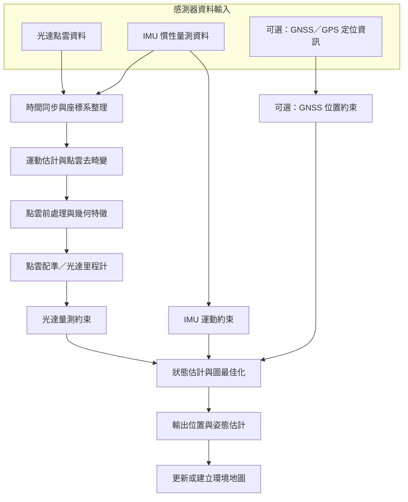

**# 第 5 章：LiDAR 光達技術**

**---**

**## 1. 本章學習目標**

* **理解光達測距物理原理**：認識飛行時間測距法（ToF, Time-of-Flight）的基本概念與距離公式，了解點雲（Point Cloud）的資料結構及其空間幾何意義。
* **認識點雲配準演算法**：了解迭代最近點（ICP）、點到平面配準、常態分佈變換（NDT）及幾何特徵提取等常見方法。各方法的細節與數學式屬於通用工程理論補充，需與綜述論文實際討論內容區分。
* **了解光達里程計與 SLAM 的發展**：以 2024 年學術綜述 *LiDAR odometry survey: recent advancements and remaining challenges* 為主要參考，認識 LOAM、LeGO-LOAM、LIO-SAM 等方法的基本概念 `[LiDAR 光達.pdf，期刊印刷第 95～118 頁（PDF 第 1～24 頁）]`。
* **理解光達系統的限制**：分析幾何特徵不足、動態物體、掃描期間的車體運動，以及雨霧等環境因素對點雲品質與定位結果的影響。

**---**

**## 2. 章節簡介**

光達（LiDAR, Light Detection and Ranging）是一種主動式光學感測器，透過發射雷射光並接收物體反射回來的訊號，估計感測器與目標物之間的距離。當系統同時取得不同方向的測距資料，便能形成三維點雲，用來描述道路、建築物、車輛及其他物體的空間幾何形狀。

光達里程計（LiDAR Odometry, LO）利用連續掃描資料估計感測器的相對運動；若再結合地圖建構、慣性測量單元（IMU）或其他定位資訊，便可形成光達同步定位與建圖（LiDAR SLAM）系統。2024 年的綜述論文整理了光達里程計的研究進展與仍待克服的挑戰 `[LiDAR 光達.pdf，期刊印刷第 95 頁（PDF 第 1 頁）]`。

本章將介紹光達測距、點雲資料、點雲配準、代表性里程計與 SLAM 方法，以及環境條件對光達系統的影響。需要注意的是，光達可以直接提供量測距離，但實際精度仍受到硬體、反射表面、量測環境及演算法影響，不能一概宣稱所有光達都具有毫米或公分級精度。

**---**

**## 3. 詳細技術小節**

**### 3.1 LiDAR 測距物理原理與硬體架構**

**#### 3.1.1 飛行時間測距法（ToF，Time-of-Flight）**

飛行時間測距法的基本概念，是測量光訊號從發射端到達目標物，再由目標物反射或散射返回接收端所經過的時間。若以往返時間估算距離，可使用下列理想化公式：

\[
d=\frac{c\cdot\Delta t}{2}
\]

* \(d\)：感測器與目標反射位置之間的距離，單位為公尺（m）。
* \(c\)：光在傳播介質中的速度。若以真空光速近似，約為 \(3.0\times10^8\ \text{m/s}\)；在空氣等介質中，傳播速度會略有差異。
* \(\Delta t\)：光訊號從發射至接收的往返時間。
* **物理意涵**：訊號往返時間越長，代表目標距離通常越遠。由於光速極快，系統需要高精度的計時與訊號處理電路。

**注意：** 上式是基本 ToF 測距模型。實際量測精度還會受到脈衝寬度、接收訊號強度、目標反射率、環境光、感測器電路與訊號處理方法等因素影響，不能只根據計時解析度就推論一定能達到毫米或公分級精度。

**#### 3.1.2 光達硬體掃描架構**

依照光束掃描與光學元件的實作方式，光達可有不同硬體架構。以下為常見技術分類的概念性整理：

1. **機械式光達（Mechanical LiDAR）**：透過馬達帶動旋轉機構或光學元件，使雷射光束掃描不同方向。此類架構可提供較大範圍的掃描視野，但機構體積、耐久性、成本與維護需求需納入考量。
2. **混合式固態光達（Hybrid Solid-State LiDAR）**：部分光學或掃描元件仍會移動，但不一定採用整個感測頭旋轉的設計。MEMS 微機電掃描鏡等技術可用於控制光束方向。
3. **固態光達（Solid-State LiDAR）**：以較少或不使用傳統大型機械旋轉機構的方式控制光束。常見技術方向包括 Flash LiDAR 與光學相控陣（OPA, Optical Phased Array）等。不同產品的掃描原理、視野與成熟度並不相同。

> **資料界線：** 上述為技術分類的概念介紹，不代表原始綜述論文已證明某一種架構是目前所有量產車的主流，也不應將「固態」一律解釋為完全沒有任何可動元件。

**#### 3.1.3 點雲資料結構（Point Cloud Data Structure）**

光達在掃描過程中，會取得多個反射點的空間位置。將這些點集合起來，便形成點雲（Point Cloud）。常見點雲資料可能包含：

\[
\mathbf{p}_i=[X_i,Y_i,Z_i,I_i,t_i]^T
\]

* \(X_i,Y_i,Z_i\)：反射點在指定座標系中的三維位置。
* \(I_i\)（Intensity）：回波強度或反射強度相關數值，其大小會受到目標表面、距離、入射角及感測器設定等因素影響，不宜直接當成材料反射率的精確測量值。
* \(t_i\)（Timestamp）：點的量測時間資訊；若感測器提供逐點時間戳記，可用於掃描期間的運動補償。
* **其他欄位**：部分設備或資料格式還可能提供 Ring（雷射通道編號）、回波序號、距離或 RGB 顏色等欄位；欄位內容依設備及資料格式而定。

**---**

**### 3.2 點雲幾何配準（Point Cloud Registration）演算法**

點雲配準的目標，是估計兩組點雲之間的相對旋轉與平移，使它們能在同一座標系中對齊。常見剛體轉換可表示為：

\[
\mathbf{q}_i\approx R\mathbf{p}_i+T
\]

其中 \(R\) 是旋轉矩陣，\(T\) 是平移向量。以下列出常見配準方法作為通用工程理論補充；實際演算法可能使用不同的對應點搜尋、特徵選取與最佳化策略。

**#### 3.2.1 迭代最近點演算法（ICP, Iterative Closest Point）**

* **點到點 ICP（Point-to-Point ICP）**：先在兩組點雲之間尋找對應點，再反覆估計旋轉與平移，使對應點之間的距離總和降低。常見目標函數為：

\[
\min_{R,T}\sum_i\left\|R\mathbf{p}_i+T-\mathbf{q}_i\right\|^2
\]

* **點到平面 ICP（Point-to-Plane ICP）**：除了對應點位置，也使用目標點附近平面的法向量，最小化轉換後的點到局部平面距離：

\[
\min_{R,T}\sum_i
\left[
\mathbf{n}_i^T(R\mathbf{p}_i+T-\mathbf{q}_i)
\right]^2
\]

其中 \(\mathbf{n}_i\) 是目標點附近局部平面的單位法向量。

* **方法限制**：ICP 類方法通常需要合理的初始位姿與足夠的重疊區域；若初始位置差距太大、點雲雜訊很多或場景幾何特徵不足，可能無法得到正確配準結果。點到平面方法在局部平面結構明顯的場景中常有優勢，但不代表在所有環境都一定較快或較穩定。

**#### 3.2.2 基於幾何特徵的配準（Feature-based Registration）**

部分光達里程計方法會根據點雲的局部幾何特性，選取較具代表性的點進行配準，以減少資料量並提高匹配效率。常見特徵包括：

* **邊緣或線狀特徵（Edge / Line Features）**：可能出現在建築物邊緣、牆角或其他幾何變化較明顯的位置。
* **平面特徵（Planar Features）**：可能出現在地面、牆面或其他局部平坦區域。
* **曲率或粗糙度指標（Curvature / Smoothness）**：可利用鄰近點的幾何分布估計局部表面變化程度，再依演算法設定選取特徵點。

不同研究使用的曲率定義、鄰域選取方式及門檻值可能不同，因此不宜把單一公式或門檻視為所有光達演算法的共同標準。

**#### 3.2.3 常態分佈變換（NDT, Normal Distributions Transform）**

NDT 是一種以機率分布描述點雲局部空間的方法。常見作法是將空間劃分成多個網格或體素（Voxel），再利用每個區域中的點估計其統計分布。配準時，演算法會評估待配準點落在這些分布中的適合程度，藉此估計兩組點雲的相對位姿。

NDT 與 ICP 的資料表示及最佳化方式不同；其效果仍會受到網格大小、點雲密度、初始位姿及環境幾何等因素影響。

**---**

**### 3.3 光達里程計（LO）與 SLAM 演算法**

光達里程計透過連續掃描資料估計感測器的相對運動；SLAM 則進一步同時處理定位與地圖建構。2024 年綜述論文整理了多種光達里程計與 SLAM 方法，包括不同特徵表示、資料配準及多感測器融合策略 `[LiDAR 光達.pdf，期刊印刷第 95～118 頁（PDF 第 1～24 頁）]`。

**#### 3.3.1 經典光達里程計架構：LOAM 與 LeGO-LOAM**

* **LOAM（LiDAR Odometry and Mapping）**：
  * LOAM 是經典的光達里程計與建圖方法，利用掃描點雲中的幾何特徵估計感測器運動，並將里程計估計與地圖建構工作分開處理。
  * 其設計重點之一，是在即時運動估計與較精細的地圖匹配之間取得平衡。不同實作的執行頻率會依硬體、資料量與參數設定而改變，不宜將單一頻率視為所有系統的固定規格。

* **LeGO-LOAM（Lightweight and Ground-Optimized LOAM）**：
  * LeGO-LOAM 是針對地面移動平台設計的輕量化 LOAM 延伸方法。
  * 其流程會利用地面分割與幾何特徵處理，降低部分非地面點對估計的干擾；實際效果仍與地形、點雲品質及場景特性有關。

**#### 3.3.2 多感測器融合光達 SLAM：LIO-SAM**

* **LIO-SAM（Lidar Inertial Odometry via Smoothing and Mapping）**：
  * LIO-SAM 結合光達與慣性測量單元（IMU）的量測資訊，透過平滑與建圖架構估計系統狀態。
  * 因子圖（Factor Graph）可將不同來源的量測表示為約束因子，再共同估計位置、姿態及其他狀態。
  * IMU 預積分（IMU Preintegration）是常見的慣性資料處理方法，可將一段時間內的高頻 IMU 量測整合成相鄰狀態之間的相對運動約束。
  * GPS 或回環偵測（Loop Closure）是否加入、如何使用，取決於系統配置及可取得的資料；不能假設每一次執行都一定具備所有外部因子。

**#### 3.3.3 光達運動畸變校正（Deskewing / Motion Compensation）**

旋轉式光達通常需要一段時間才能完成一次掃描。若車輛在掃描期間持續移動，不同時間取得的點就會對應到不同的感測器位置與姿態，因此同一幀點雲可能出現幾何扭曲。

* **形成原因**：掃描期間車輛的平移或旋轉，使同一個靜態物體在不同量測時刻被記錄於不同座標位置。
* **校正概念**：若有逐點時間資訊及可靠的運動估計，可將不同時間取得的點轉換至同一參考時刻或參考座標系，降低掃描期間的運動影響。
* **可用資訊**：部分系統會使用 IMU、輪速計或其他位姿估計結果進行運動補償。可用感測器與校正方式依系統設計而異。

> 原文所列「掃描固定耗時 100 ms」、「車速 72 km/h 時必定位移 2 公尺」及「IMU 固定使用 100～200 Hz」均屬特定條件下的示例或規格，不能視為所有光達設備的共同數值，因此本修正版不將其列為通用結論。

**---**

**### 3.4 基準測試、幾何退化與環境挑戰**

**#### 3.4.1 KITTI 等基準資料集評測概念**

研究人員會使用公開資料集評估光達里程計與 SLAM 系統。常見評估內容包括：

1. **平移誤差（Translation Error）**：衡量估計軌跡與參考軌跡之間的位置差異。部分評測會將誤差正規化為行駛距離的百分比。
2. **旋轉誤差（Rotational Error）**：衡量估計姿態與參考姿態之間的角度差異。
3. **絕對軌跡誤差（Absolute Trajectory Error, ATE）**：比較估計軌跡與參考軌跡在對齊後的整體位置差異。
4. **相對位姿誤差（Relative Pose Error, RPE）**：評估指定時間間隔或移動距離內的相對位姿估計誤差。

不同資料集與論文可能採用不同的計算設定，因此比較演算法結果時，必須同時確認資料集、評測指標、對齊方式及測試條件。不能將某個方法在特定資料集上的結果直接當成所有場景的性能保證。

**#### 3.4.2 幾何退化環境（Geometric Degeneracy）**

當場景缺乏足夠且分布多樣的幾何特徵時，點雲配準可能無法充分約束所有方向的位姿變化。例如，長直走廊、隧道或大面積平坦牆面可能只提供部分方向的幾何資訊。

* **形成原因**：若大量特徵集中在相似方向或相似平面，配準最佳化對某些方向的運動可能不敏感。
* **可能結果**：估計問題的資訊矩陣或 Hessian 矩陣可能呈現病態，部分自由度的估計不穩定，導致定位漂移。
* **改善方向**：可結合 IMU、輪速計、GNSS、地圖先驗或其他感測器資訊，增加環境幾何不足時的運動約束。

**#### 3.4.3 雨霧等環境因素**

* **水滴散射與回波干擾**：雨滴、霧滴及空氣中的懸浮粒子可能使雷射光產生散射或衰減，並造成額外回波或雜訊點。
* **能見度與量測品質下降**：在濃霧、大雨或飛雪等條件下，光達的有效量測距離與點雲品質可能受到影響。
* **物體表面影響**：不同材質、顏色、反射特性及入射角可能改變回波強度與量測可靠度。

因此，光達雖然具有主動量測能力，但不代表它完全不受天候影響，也不能將其視為全天候都能提供相同品質資料的感測器。

**---**

**## 4. 核心技術名詞及繁體中文解釋**

| 英文專有名詞 | 縮寫 | 繁體中文名詞 | 核心定義與解釋 |
| :--- | :--- | :--- | :--- |
| **Light Detection and Ranging** | LiDAR | 光達／光學雷達 | 主動發射光訊號並接收回波，以估計目標距離或空間位置的感測技術。 |
| **Point Cloud Registration** | - | 點雲配準 | 求解不同時間或不同座標系下點雲之間的相對轉換，使點雲能夠對齊的計算過程。 |
| **LiDAR Odometry** | LO | 光達里程計 | 利用連續光達掃描資料估計感測器相對位置與姿態變化的方法。 |
| **Deskewing / Motion Compensation** | - | 運動去畸變／運動補償 | 修正掃描期間感測器移動所造成點雲幾何扭曲的處理方法。 |
| **Geometric Degeneracy** | - | 幾何退化 | 場景幾何資訊不足或分布不均，使部分位姿自由度難以可靠估計的情況。 |
| **Factor Graph** | - | 因子圖 | 將狀態變數與量測約束表示為節點及因子的圖形化最佳化模型。 |

**---**

**## 5. 重要原理與技術運作流程**

以下以光達與 IMU 融合的 SLAM 系統作為概念示意。不同系統的模組順序、外部定位資訊及最佳化方式可能不同；此圖是通用流程整理，不應視為單一論文程式架構的逐項複製。

1. **感測器資料輸入**：取得光達點雲與 IMU 等感測器資料，並確認時間戳記與座標系定義。
2. **前處理與運動補償**：依設備資料格式處理點雲，若具備逐點時間及運動資訊，可進行去畸變。
3. **幾何特徵與配準**：從點雲中選取可用幾何資訊，估計相鄰掃描之間的相對位姿。
4. **融合與最佳化**：視系統架構加入 IMU 或 GNSS 等約束，估計較一致的位姿。
5. **定位與建圖**：輸出感測器位置、姿態及環境地圖，供後續定位與自動駕駛模組使用。

**---**

**## 6. 實際應用案例**

**### 6.1 自動駕駛車輛的光達環境感知與定位**

* **環境幾何量測**：車載光達可量測周圍物體的距離與方向，形成三維點雲，協助系統描述道路邊界、建築物、車輛及其他障礙物的幾何位置。
* **定位與地圖比對**：車輛可利用即時點雲與先前建立的地圖進行比對，估計目前所在位置；也可透過連續點雲配準估計短時間內的相對運動。
* **多感測器整合**：若系統同時具有 Camera、Radar、IMU 或 GNSS，可將不同感測器提供的資訊整合，以補足單一感測器的限制。

> **案例界線：** 原文所列 Waymo 第五代光達配置、300 公尺探測距離、網球辨識距離及四角補盲設備等具體敘述，未能由目前已知的原始來源頁面確認，因此本章不保留為已驗證案例。若要介紹特定車廠的硬體配置，應另引用該車廠官方技術資料。

**---**

**## 7. 優點、缺點與技術限制**

| 評估維度 | LiDAR 光達核心優勢 | LiDAR 光達主要工程瓶頸 |
| :--- | :--- | :--- |
| **距離與幾何資訊** | 可主動量測目標距離，形成三維點雲，提供環境幾何資訊。 | 量測品質會受到距離、反射率、入射角、點雲密度與設備規格影響；不能宣稱所有設備都固定達到厘米級精度。 |
| **光照條件** | 自行發射光訊號，不必完全依賴環境可見光，因此在夜間仍可取得量測資料。 | 仍可能受到強烈外部光源、感測器設計及訊號品質等因素影響。 |
| **語意資訊** | 點雲可提供物體的空間形狀與位置資訊。 | 一般幾何點雲不直接包含完整色彩與文字語意，通常需搭配 Camera 或其他辨識方法。 |
| **天候適應性** | 在一般環境下可提供主動式距離量測。 | 雨、霧、雪及空氣懸浮粒子可能造成散射、衰減與雜訊，降低有效量測品質。 |
| **硬體與整合** | 可依車輛需求選擇不同掃描架構與安裝位置。 | 成本、體積、功耗、散熱、耐久性及車身安裝位置均需納入設計考量。 |

**---**

**## 8. 圖解建議**

1. **點雲運動畸變前後對照圖**：以同一個靜態場景呈現掃描期間車輛移動造成的點雲扭曲，再比較進行運動補償前後的差異。
2. **光達 SLAM 因子圖示意圖**：繪製不同時間的車體位姿節點，並以 IMU、光達里程計及可選 GNSS 約束連接，呈現多種量測共同估計位姿的概念。
3. **點雲幾何特徵示意圖**：以建築物邊緣、地面及牆面為例，標示線狀與平面幾何特徵，說明配準時可利用的空間資訊。

**---**

**## 9. 專有名詞彙整表**

| 名詞 | 英文全名 | 中文解釋 |
| :--- | :--- | :--- |
| **ToF** | Time of Flight | 飛行時間測距，利用訊號發射與接收之間的時間差估計目標距離。 |
| **ICP** | Iterative Closest Point | 迭代最近點演算法，透過反覆建立對應點並估計剛體轉換，使兩組點雲逐步對齊。 |
| **LOAM** | LiDAR Odometry and Mapping | 光達里程計與建圖方法，利用點雲幾何特徵估計運動並建立地圖。 |
| **NDT** | Normal Distributions Transform | 常態分佈變換，以局部機率分布描述點雲並進行配準的方法。 |
| **Mie Scattering** | Mie Scattering | 米氏散射，描述光波與尺寸接近或大於波長的粒子互動時產生的散射現象；雨霧中的水滴可能造成光達回波干擾。 |
| **IMU** | Inertial Measurement Unit | 慣性測量單元，通常量測角速度與加速度，可提供運動估計所需的資訊。 |
| **SLAM** | Simultaneous Localization and Mapping | 同步定位與建圖，使系統在建立環境地圖的同時估計自身位置。 |

**---**

**## 10. 本章重點整理**

1. 光達可透過 **ToF 飛行時間測距**等方式估計目標距離，並將多個量測點組成三維點雲，提供環境幾何資訊。
2. **點雲配準**透過旋轉、平移及幾何對應關係，使不同時間取得的點雲對齊；ICP、點到平面方法及 NDT 是常見的配準技術。
3. **LOAM、LeGO-LOAM 與 LIO-SAM**代表不同的光達里程計或多感測器融合研究方向；實際效能會受到資料品質、硬體及場景影響。
4. **運動去畸變（Deskewing）**可降低掃描期間車輛移動造成的點雲形變，但需要適當的時間資訊與運動估計。
5. 幾何特徵不足可能造成定位退化，雨霧等天候也可能影響回波品質，因此光達系統仍需搭配其他感測器與演算法提升可靠性。

**---**

**## 參考資料**

* Lee, D., Jung, M., Yang, W., & Kim, A. (2024). *LiDAR odometry survey: recent advancements and remaining challenges*. Intelligent Service Robotics, 17, 95–118. `[LiDAR 光達.pdf，期刊印刷第 95～118 頁（PDF 第 1～24 頁）]`
