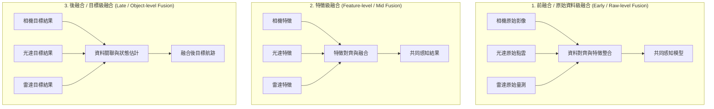
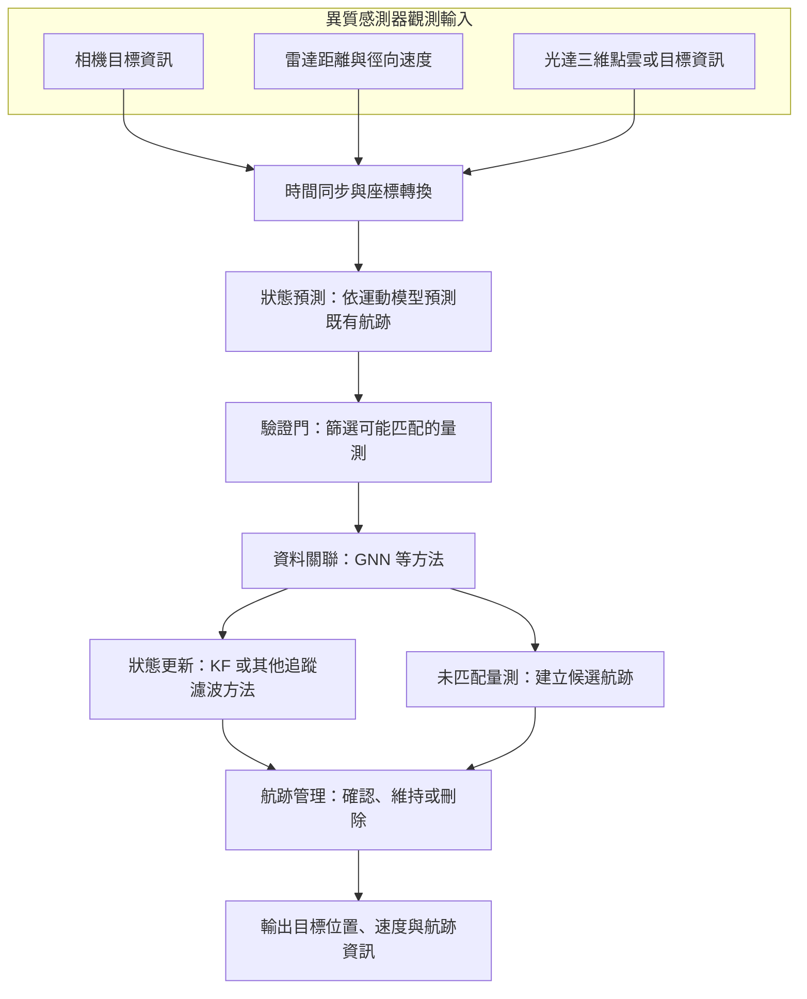

**# 第 6 章：Radar 雷達技術與感測器融合**

**---**

**## 1. 本章學習目標**

* **掌握毫米波雷達測距與都卜勒測速機制**：理解 FMCW（調頻連續波）雷達如何利用拍頻估算目標距離，以及如何利用回波相位變化估算徑向相對速度。
* **理解前融合、特徵融合與後融合架構**：掌握不同資料層級的融合方式、資訊保留程度與系統設計取捨。
* **掌握線性卡爾曼濾波（KF）狀態估計**：依據國立成功大學碩士論文中的線性卡爾曼濾波推導，理解狀態預測、量測更新與協方差更新；另以通用工程理論介紹 EKF 的用途與差異。
* **理解多目標資料關聯與航跡管理**：認識馬氏距離、全域最近鄰法（GNN）及航跡建立、確認、維持與刪除等概念。

**---**

**## 2. 章節簡介**

自動駕駛車輛通常會使用攝影機（Camera）、光達（LiDAR）與毫米波雷達（Radar）等感測器取得周遭環境資訊。不同感測器具有不同的物理特性：攝影機能提供顏色與物件外觀等語意資訊；光達能量測周遭物體的三維空間位置；毫米波雷達則能量測目標距離，並利用都卜勒效應取得目標的徑向相對速度。

然而，單一感測器仍有其限制。例如，攝影機可能受到光照、眩光或遮蔽影響；光達點雲可能受到雨、霧及其他環境條件干擾；雷達則可能出現角度解析度較低、反射雜波及多重路徑等問題。因此，自動駕駛系統會依照感知需求，整合不同感測器的資訊，形成**感測器資料融合（Sensor Fusion）**。

本章以國立成功大學碩士論文《結合光達相機與雷達之追蹤演算法發展及其於自駕車之應用》為主要技術資料，介紹感測器特性、座標轉換、線性卡爾曼濾波、α-β 濾波與全域最近鄰資料關聯。至於 FMCW 雷達原理、融合架構分類及 EKF 等內容，則屬於通用工程知識補充，不應視為該論文全部實作的方法。

**---**

**## 3. 詳細技術小節**

**### 3.1 毫米波雷達（mmWave Radar）物理機制**

毫米波（Millimeter Wave）通常指頻率約 30～300 GHz、波長約 1～10 mm 的電磁波。車用雷達常見工作頻段包含 77 GHz 附近及 79 GHz 附近的頻段；實際頻率配置需依設備規格與適用法規而定。成大論文的感測器比較表可作為雷達特性與其他感測器比較的參考 \`[感測器融合.pdf，印刷第 7～9 頁（PDF 第 21～23 頁，表 2.1）]\`。

1. **調頻連續波（FMCW, Frequency Modulated Continuous Wave）**：
   * FMCW 雷達會連續發射頻率隨時間改變的訊號，常以啁啾訊號（Chirp）表示。若在一個調頻週期內近似線性掃頻，調頻斜率可表示為：

     \[
     S = \frac{B}{T_c}
     \]

     其中，\(B\) 為掃頻頻寬，\(T_c\) 為啁啾訊號的掃頻時間。
   * 電磁波往返目標所產生的時間延遲可近似表示為：

     \[
     \Delta t = \frac{2R}{c}
     \]

     其中，\(R\) 為目標距離，\(c\) 為電磁波傳播速度。
   * 對於忽略都卜勒頻移、目標在量測期間近似靜止的簡化情況，混頻後的拍頻 \(f_b\) 與距離關係可表示為：

     \[
     f_b = S\Delta t
     \]

     因此：

     \[
     R = \frac{c f_b}{2S}
       = \frac{c T_c f_b}{2B}
     \]

   * **物理概念澄清**：上式是簡化的 FMCW 測距關係。當目標具有相對運動時，拍頻也會受到都卜勒頻移影響，實際雷達系統通常會透過多個啁啾訊號及訊號處理方法，分離或估計距離與速度資訊。FMCW 並不是單純以計時器直接量測完整往返時間的 ToF 方法。

2. **都卜勒相對速度測量（Doppler Velocity）**：
   * 當雷達與目標之間存在相對運動時，接收回波的相位會隨時間改變，並產生都卜勒頻移（Doppler Frequency）。
   * FMCW 雷達可利用連續啁啾訊號之間的相位變化，估算目標沿雷達視線方向的**徑向相對速度**。常見訊號處理方式包含對快時間與慢時間資料進行二維快速傅立葉轉換（2D-FFT），以形成距離－速度資訊。
   * 雷達輸出的速度主要是徑向速度，不代表能直接取得目標完整的二維或三維速度向量；完整運動狀態仍可能需要多次量測、運動模型或其他感測器資訊。

3. **雷達散射截面積（RCS, Radar Cross Section）**：
   * RCS 用來描述物體在特定雷達頻率、入射方向、物體形狀與材質條件下，對雷達波的等效散射能力。
   * RCS 常以平方公尺（m²）或對數單位 dBsm 表示。它不是只由物體大小決定，也會受到形狀、材質、姿態、頻率與觀測角度影響。
   * 不同物體的回波強度可能差異很大，因此行人、自行車及其他弱勢用路人的偵測，需要搭配適當的雷達硬體與訊號處理演算法。不能只依物體類別指定一個固定的 RCS 數值。

**---**

**### 3.2 感測器融合架構（Fusion Architectures）分類**

依照融合資料所處理的層級，常見的感測器融合方式可概略分為前融合、特徵級融合與後融合。以下是通用工程分類，用來說明不同系統架構的設計概念，並非表示成大論文完整實作了這三種架構。

1. **前融合（Early Fusion / Raw-level Fusion）**：
   * 在感測器資料進入高階辨識或決策之前，先整合較底層的資料，例如影像、點雲或雷達量測。
   * 優點是有機會保留較多原始資訊；限制是不同感測器的資料格式、解析度、時間頻率與座標系不同，因此需要妥善處理時空對齊，系統設計也較複雜。

2. **後融合（Late Fusion / Object-level Fusion）**：
   * 各感測器先各自進行感知或目標偵測，再將目標位置、速度、分類或航跡等結果交由融合模組處理。
   * 優點是各感測器模組可以相對獨立開發與測試；限制是原始資料中的部分細節可能已在前端處理過程中流失，且各感測器輸出格式與不確定度需要統一。

3. **特徵級融合（Feature-level / Mid Fusion）**：
   * 先由不同感測器的模型擷取中間層特徵，再將特徵轉換至可比較的表示方式進行整合，例如使用鳥瞰視角（BEV, Bird's-Eye View）特徵。
   * 此方法能在原始資料與最終目標結果之間整合資訊，但需要設計特徵對齊方式及融合模型，計算資源需求也會依模型架構而不同。

**---**

**### 3.3 異質多感測器時空同步校準（Spatial-Temporal Alignment）**

**#### 3.3.1 空間座標校準（Spatial Calibration）**

相機、光達與雷達通常安裝在車輛不同位置，因此各感測器量測資料會使用不同的座標系。若要整合資料，就必須透過外部參數（Extrinsic Parameters），將感測器座標轉換到共同的車輛座標系（Vehicle Coordinate Frame）。

常見的剛體座標轉換可表示為：

\[
\mathbf{P}_{vehicle}
=
\mathbf{R}_{sensor\rightarrow vehicle}
\mathbf{P}_{sensor}
+
\mathbf{T}_{sensor\rightarrow vehicle}
\]

其中，\(\mathbf{R}\) 為旋轉矩陣，\(\mathbf{T}\) 為平移向量。矩陣與向量的維度需依使用二維或三維座標表示而定。

成大論文中包含感測器座標轉換與旋轉矩陣相關內容，可參考其座標轉換公式及歐拉角旋轉矩陣說明 \`[感測器融合.pdf，印刷第 16～17 頁（PDF 第 30～31 頁）]\`。實際使用時，仍須依照論文所定義的座標軸方向與轉換順序，避免旋轉方向或矩陣相乘順序錯誤。

**#### 3.3.2 時間同步（Temporal Synchronization）**

不同感測器可能具有不同的取樣頻率、曝光時間、掃描時間與資料傳輸延遲。若直接融合不同時間點的資料，目標在移動時就可能出現位置偏差。

* **硬體時間同步**：可使用共同時鐘、觸發訊號或時間同步協定，讓各感測器資料具有可比較的時間戳記。PTP（Precision Time Protocol，精確時間協定，IEEE 1588）及 GNSS PPS（Pulse Per Second，秒脈衝訊號）是常見的同步技術選項，但實際精度取決於設備、網路與系統配置。
* **軟體時間補償**：若感測器資料時間不一致，可依時間戳記及目標運動模型，將量測或狀態估計轉換至共同參考時間。補償結果會受到運動模型與量測延遲影響，不能保證所有情況都完全消除誤差。

**---**

**### 3.4 物體追蹤與狀態估計核心演算法**

**#### 3.4.1 線性卡爾曼濾波（KF, Kalman Filter）與擴展卡爾曼濾波（EKF）**

**重要來源區分：**成大碩士論文在追蹤演算法中使用的是**線性卡爾曼濾波（Linear Kalman Filter）**，並結合 α-β 濾波與 GNN 資料關聯；不能將論文的方法直接寫成 EKF。論文中的線性卡爾曼濾波推導可參考公式 3.15 至 3.23 \`[感測器融合.pdf，印刷第 25～27 頁（PDF 第 39～41 頁）]\`。以下先介紹 KF，再以通用工程理論補充 EKF。

* **線性狀態空間模型**：
  \[
  \mathbf{x}_k = \mathbf{F}_k\mathbf{x}_{k-1}
  + \mathbf{B}_k\mathbf{u}_k + \mathbf{w}_k
  \]

  \[
  \mathbf{z}_k = \mathbf{H}_k\mathbf{x}_k + \mathbf{v}_k
  \]

  其中，\(\mathbf{x}_k\) 是系統狀態，\(\mathbf{F}_k\) 是狀態轉移矩陣，\(\mathbf{u}_k\) 是控制輸入，\(\mathbf{B}_k\) 是控制矩陣，\(\mathbf{z}_k\) 是量測值，\(\mathbf{H}_k\) 是量測矩陣；\(\mathbf{w}_k\) 與 \(\mathbf{v}_k\) 分別代表製程雜訊與量測雜訊。

* **預測步（Prediction Step）**：
  \[
  \hat{\mathbf{x}}_{k|k-1}
  =
  \mathbf{F}_k\hat{\mathbf{x}}_{k-1|k-1}
  + \mathbf{B}_k\mathbf{u}_k
  \]

  \[
  \mathbf{P}_{k|k-1}
  =
  \mathbf{F}_k\mathbf{P}_{k-1|k-1}\mathbf{F}_k^T
  + \mathbf{Q}_k
  \]

  預測步利用前一時刻的狀態與運動模型，估計目前狀態及其不確定度。 \(\mathbf{P}\) 為估計誤差協方差矩陣，\(\mathbf{Q}_k\) 為製程雜訊協方差矩陣。

* **更新步（Update Step）**：
  \[
  \mathbf{K}_k =
  \mathbf{P}_{k|k-1}\mathbf{H}_k^T
  \left(
  \mathbf{H}_k\mathbf{P}_{k|k-1}\mathbf{H}_k^T
  + \mathbf{R}_k
  \right)^{-1}
  \]

  \[
  \hat{\mathbf{x}}_{k|k}
  =
  \hat{\mathbf{x}}_{k|k-1}
  + \mathbf{K}_k
  \left(
  \mathbf{z}_k-\mathbf{H}_k\hat{\mathbf{x}}_{k|k-1}
  \right)
  \]

  \[
  \mathbf{P}_{k|k}
  =
  (\mathbf{I}-\mathbf{K}_k\mathbf{H}_k)
  \mathbf{P}_{k|k-1}
  \]

  \(\mathbf{K}_k\) 是卡爾曼增益，\(\mathbf{R}_k\) 是量測雜訊協方差矩陣。更新步會依照模型預測與實際量測的不確定度，調整最終狀態估計。

* **EKF 通用工程補充**：
  * 當狀態模型或量測模型為非線性時，可使用擴展卡爾曼濾波（Extended Kalman Filter, EKF），在目前估計值附近對非線性函數進行一階線性化。
  * 例如雷達可能提供距離 \(r\)、方位角 \(\theta\) 與徑向速度 \(\dot r\)，若狀態向量包含目標位置與速度，可使用下列簡化量測模型：

    \[
    h(\mathbf{x}) =
    \begin{bmatrix}
    \sqrt{x^2+y^2}\\
    \operatorname{atan2}(y,x)\\
    \dfrac{xv_x+yv_y}{\sqrt{x^2+y^2}}
    \end{bmatrix}
    \]

  * EKF 會對狀態函數 \(f\) 與量測函數 \(h\) 分別計算雅可比矩陣：

    \[
    \mathbf{F}_k =
    \left.
    \frac{\partial f}{\partial \mathbf{x}}
    \right|_{\hat{\mathbf{x}}_{k-1|k-1}},
    \qquad
    \mathbf{H}_k =
    \left.
    \frac{\partial h}{\partial \mathbf{x}}
    \right|_{\hat{\mathbf{x}}_{k|k-1}}
    \]

  * 上述 EKF 量測模型是通用工程示例，並非成大論文所採用的濾波器公式。實際使用時，還需考慮角度單位、角度差值正規化、座標系定義，以及目標接近原點時的數值穩定性。

**#### 3.4.2 資料關聯演算法（Data Association）**

在多目標環境中，感測器每次可能產生多筆量測資料。追蹤系統必須判斷每筆新量測應該對應哪一條既有航跡，這個過程稱為資料關聯（Data Association）。

成大論文的追蹤方法包含全域最近鄰（GNN）資料關聯，可參考論文中相關演算法說明 \`[感測器融合.pdf，印刷第 27～35 頁（PDF 第 41～49 頁）]\`。

* **馬氏距離（Mahalanobis Distance）**：
  * 馬氏距離會考慮量測分布的協方差，不只比較兩點的幾何距離。常見平方距離形式為：

    \[
    d_M^2 =
    (\mathbf{z}-\hat{\mathbf{z}})^T
    \mathbf{S}^{-1}
    (\mathbf{z}-\hat{\mathbf{z}})
    \]

    其中，\(\mathbf{z}\) 是新量測，\(\hat{\mathbf{z}}\) 是預測量測，\(\mathbf{S}\) 是新息協方差矩陣（Innovation Covariance）。在線性 KF 中，常見形式為：

    \[
    \mathbf{S} =
    \mathbf{H}\mathbf{P}\mathbf{H}^T+\mathbf{R}
    \]

  * 馬氏距離可搭配驗證門（Validation Gate），先排除與既有航跡差異過大的量測，降低錯誤配對機率。

* **全域最近鄰法（GNN, Global Nearest Neighbor）**：
  * GNN 會建立航跡與量測之間的代價矩陣，再尋找整體代價較低的配對結果。
  * 在適當的二分圖指派問題中，可使用匈牙利演算法（Hungarian Algorithm）求解一對一指派。實際系統還需要處理未匹配量測、未匹配航跡及門檻限制。

* **機率數據關聯（PDA, Probabilistic Data Association）**：
  * PDA 是另一種多目標追蹤相關方法，會考慮驗證門內多筆量測可能屬於同一航跡的機率，而不是只選擇單一量測。
  * PDA 在此作為通用工程知識補充；目前章節所依據的成大論文內容，不應被描述為已實作 PDA。

**#### 3.4.3 航跡管理（Track Management）**

航跡管理負責處理目標從首次出現、持續被觀測，到離開感測範圍或長時間未被偵測的生命週期。常見系統可包含以下概念：

* **暫態航跡（Tentative Track）**：新量測建立的候選航跡，尚未累積足夠證據確認為穩定目標。
* **確認航跡（Confirmed Track）**：當候選航跡在多次更新中持續獲得合理量測支持，就可提升為確認航跡。部分系統會使用 \(M/N\) 邏輯，例如在最近 \(N\) 次機會中至少成功匹配 \(M\) 次；實際門檻由系統設計決定，不能將特定數字視為通用標準。
* **航跡維持（Track Maintenance）**：持續使用新量測修正目標的位置、速度及其他狀態估計。
* **航跡刪除（Track Deletion）**：若航跡長時間未獲得有效量測，或其狀態不再符合系統條件，便可依規則刪除，避免保留過期目標。

**---**

**## 4. 核心技術名詞及繁體中文解釋**

| 英文專有名詞 | 縮寫 | 繁體中文名詞 | 核心定義與解釋 |
| :--- | :--- | :--- | :--- |
| **mmWave Radar** | - | 毫米波雷達 | 使用毫米波頻段電磁波進行環境量測的雷達，可提供目標距離及徑向速度等資訊。 |
| **Frequency Modulated Continuous Wave** | FMCW | 調頻連續波 | 透過連續改變發射訊號頻率，利用回波拍頻估算目標距離的雷達技術。 |
| **Extended Kalman Filter** | EKF | 擴展卡爾曼濾波 | 以雅可比矩陣對非線性模型進行局部線性化的狀態估計方法；本章列為通用工程補充。 |
| **Mahalanobis Distance** | - | 馬氏距離 | 考慮協方差的統計距離，可用於判斷量測與預測航跡是否相符。 |
| **Global Nearest Neighbor** | GNN | 全域最近鄰資料關聯 | 將多條航跡與多筆量測建立整體配對問題，尋找總體代價較低的指派結果。 |
| **Radar Cross Section** | RCS | 雷達散射截面積 | 描述物體在特定條件下對雷達電磁波的等效散射能力。 |
| **α-β Filter** | - | α-β 濾波器 | 一種以位置與速度估計為基礎的追蹤濾波方法，可用於修正目標運動狀態。 |

**---**

**## 5. 重要原理與技術運作流程**

以下流程圖以通用的多感測器後融合追蹤概念呈現，包含座標對齊、狀態預測、資料關聯、狀態更新與航跡管理。圖中的 KF／EKF 是可選擇的狀態估計方法示意；成大論文實際採用的方法應以論文所述的線性 KF、α-β 濾波及 GNN 為準 \`[感測器融合.pdf，印刷第 25～35 頁（PDF 第 39～49 頁）]\`。

**---**

**## 6. 實際應用案例**

**### 6.1 雷達、相機與光達資訊整合之目標追蹤**

* **論文實際研究內容**：成大碩士論文以光達、相機與雷達為研究對象，探討感測器資訊整合及目標追蹤方法，並說明座標轉換、濾波與資料關聯等技術。論文所描述的追蹤方法包含線性卡爾曼濾波、α-β 濾波與 GNN，應依原文描述其方法與實驗結果 \`[感測器融合.pdf]\`。
* **通用工程應用說明**：在道路情境中，雷達可提供目標距離與徑向速度，相機可補充車輛、行人及交通標誌等外觀語意，光達則可提供三維空間形狀資訊。系統將不同感測器的資料轉換到共同座標系與時間基準，再透過資料關聯及狀態估計，形成較連續的目標航跡。
* **重要限制**：不能僅根據論文有使用多種感測器，就推論論文已完成特定逆光測試、CARLA 模擬驗證，或證明 EKF 能自動調整雷達權重。這些都需要原始實驗內容或額外資料支持。

**---**

**## 7. 優點、缺點與技術限制**

**### 三大車載感測器物理特性全方位對比矩陣**

下表依照成大論文的感測器特性比較方向整理，並以一般工程原理補充各感測器的典型優缺點。不同設備的性能會受到硬體規格、安裝位置、環境與演算法影響，因此不應把表中的定性描述視為所有產品都適用的固定規格 \`[感測器融合.pdf，印刷第 7～9 頁（PDF 第 21～23 頁，表 2.1）]\`。

| 評估特徵 | 攝影機（Camera） | 光學雷達（LiDAR） | 毫米波雷達（mmWave Radar） |
| :--- | :---: | :---: | :---: |
| **外觀與語意資訊** | **豐富**，可提供顏色、紋理及文字線索 | 有三維形狀資訊，但一般不直接提供自然色彩語意 | 語意資訊有限，通常需搭配辨識演算法 |
| **空間幾何資訊** | 由影像推估深度，受視角及演算法影響 | **可提供三維距離與點雲資訊** | 可提供距離與方向估計，角度解析度依設備而異 |
| **直接測距能力** | 一般單目相機不直接量測絕對距離；可透過雙目或其他方法估計 | **可直接量測距離** | **可直接量測距離** |
| **速度資訊** | 通常需透過連續影像與追蹤估算 | 通常需透過連續掃描與追蹤估算 | **可利用都卜勒效應取得徑向速度** |
| **環境適應性** | 可能受逆光、低照度、雨滴及遮蔽影響 | 可能受雨、霧、灰塵及反射條件影響 | 通常不依賴可見光，雨霧環境下仍可提供量測，但並非完全不受天候影響 |
| **角度與形狀細節** | 影像細節豐富 | 可提供較完整的三維幾何形狀 | 通常較難提供細緻的物體形狀 |
| **主要限制** | 深度估計、光照及遮蔽問題 | 成本、點雲處理量與環境干擾 | 角度解析度、雜波、多重路徑及目標分類限制 |

**感測器融合的主要優點：**

1. **資訊互補**：不同感測器提供不同種類的環境資訊，可降低單一感測器資訊不足的影響。
2. **追蹤穩定性**：透過運動模型與濾波方法，可降低量測雜訊對目標位置及速度估計的影響。
3. **提升環境理解能力**：整合外觀、距離、速度與三維幾何資訊，有助於系統判斷周遭交通參與者的狀態。

**感測器融合的主要缺點與限制：**

1. **校準需求高**：不同感測器需要正確的座標轉換與時間同步，否則可能產生位置偏差。
2. **系統複雜度增加**：感測器數量增加，也會增加資料處理、通訊、運算及維護需求。
3. **量測不確定性**：各感測器都有誤差與漏檢情況，融合演算法仍可能發生錯誤關聯或追蹤中斷。
4. **環境與硬體限制**：雷達可能受到雜波或多重路徑影響；光達與相機也可能受到天候及遮蔽影響，不能將任何一種感測器描述為完全不受環境干擾。

**---**

**## 8. 圖解建議**

1. **FMCW 雷達訊號波形圖**：展示發射啁啾訊號與接收回波的頻率變化，標示往返延遲、拍頻及都卜勒頻移，說明雷達如何估算目標距離與徑向速度。
2. **卡爾曼濾波狀態估計圖**：以預測值、感測器量測值及更新後估計值呈現狀態估計過程，並用不同大小的誤差範圍表示不確定度變化。
3. **多感測器座標轉換示意圖**：展示相機、光達與雷達安裝在車身不同位置時，如何透過旋轉矩陣和平移向量轉換到共同車輛座標系。

**---**

**## 9. 專有名詞彙整表**

| 名詞 | 英文全名 | 中文解釋 |
| :--- | :--- | :--- |
| **FMCW** | Frequency Modulated Continuous Wave | 調頻連續波技術，透過連續改變發射頻率並分析回波拍頻，估算目標距離與速度。 |
| **Doppler Effect** | Doppler Effect | 都卜勒效應，發射端與接收端或目標之間存在相對運動時，接收訊號頻率會產生偏移。 |
| **Kalman Gain** | Kalman Gain (\(K\)) | 卡爾曼增益，用來依據模型預測與量測的不確定度，計算狀態更新時的權重。 |
| **Validation Gate** | Validation Gate | 驗證門，依照預測量測與不確定度範圍，篩選可能屬於某條航跡的量測。 |
| **Sensor Fusion** | Sensor Fusion | 感測器融合，整合不同感測器提供的資訊，以取得更完整的環境或目標狀態估計。 |
| **Data Association** | Data Association | 資料關聯，判斷新量測與既有目標航跡之間的對應關係。 |
| **Track Management** | Track Management | 航跡管理，負責建立、確認、維持及刪除追蹤目標。 |

**---**

**## 10. 本章重點整理**

1. **毫米波雷達**可利用 FMCW 拍頻估算目標距離，並透過都卜勒效應估計目標的徑向相對速度；但雷達仍可能受到雜波、多重路徑及角度解析度限制。
2. **感測器融合**可整合相機的外觀語意、光達的三維幾何資訊，以及雷達的距離與徑向速度資訊；實際系統必須處理不同感測器的時間同步與座標轉換。
3. **線性卡爾曼濾波（KF）**透過預測步與更新步估計目標狀態；EKF 則是處理非線性模型的延伸方法，不能將兩者混為一談。
4. **GNN 資料關聯**可協助建立量測與既有航跡之間的配對關係；搭配航跡管理，能將多次量測整理成連續的目標追蹤結果。
5. 成大論文的主要追蹤方法應依原文表述為**線性卡爾曼濾波、α-β 濾波與 GNN**；FMCW、EKF、PDA 及前／中／後融合分類則屬於本章補充的通用工程知識。

**參考資料**

* 陳威廷，莊智清指導，《結合光達相機與雷達之追蹤演算法發展及其於自駕車之應用》，國立成功大學電機工程學系碩士論文，2019 年 7 月。
* 本章 FMCW、EKF 與融合架構說明屬通用工程理論補充；若需作為正式研究引用，應另補充雷達原理、濾波器及多感測器融合的原始技術文獻。
