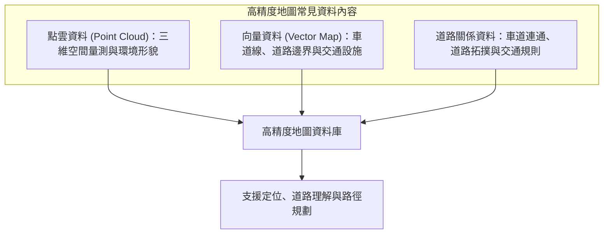
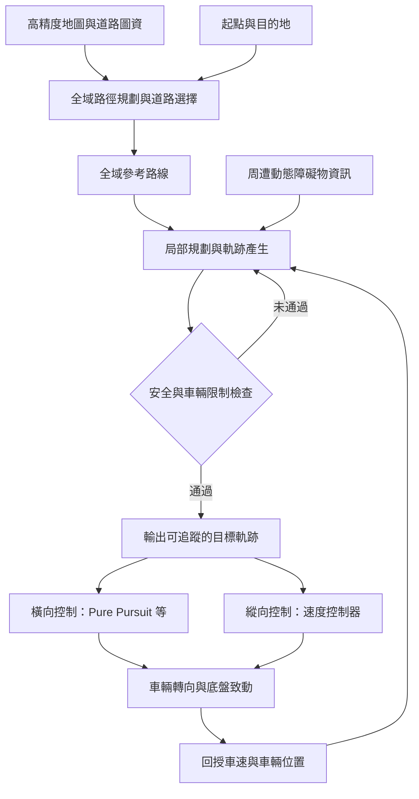

**# 第 7 章：路徑規劃、自主決策與車輛控制**

**---**

**## 1. 本章學習目標**

* **理解高精度地圖（HD Map）的資料內容與應用價值**：依據高精度地圖教學論文，認識點雲地圖、向量地圖及道路元素的表示方式，理解地圖如何支援自動駕駛定位與路徑規劃。
* **掌握全域路徑規劃與道路圖資選路概念**：依據車輛研究測試中心（ARTC）技術專文，理解道路圖資、道路屬性、路徑長度及路徑選擇的關係；另以通用工程理論補充 Dijkstra 與 A* 演算法。
* **理解局部動態軌跡規劃**：認識 Frenet 座標系、五次多項式及加加速度（Jerk）等常見規劃概念，並了解這些方法需要依據車輛動力學與道路情境設計。
* **理解車輛底盤閉迴路控制**：認識 Pure Pursuit、Stanley 與 PID 等常見控制方法，並區分來源文件實際提及的 Pure Pursuit 與其他通用工程補充。

**---**

**## 2. 章節簡介**

當自動駕駛車透過感測器掌握周遭環境後，還必須決定前往目的地的路線、選擇適當的行駛路徑，並將規劃結果轉換成車輛能夠執行的轉向、加速與煞車命令。

路徑規劃通常可以從不同尺度理解。全域路徑規劃著重於從起點前往目的地的道路選擇；局部規劃則需要考慮車輛附近的動態障礙物與可行駛空間；車輛控制模組則依照規劃軌跡調整方向與速度。

高精度地圖（HD Map）能提供道路幾何、車道及交通設施等資訊，協助車輛定位與規劃。ARTC 技術專文則以道路圖資選擇最佳行駛路徑為主題，介紹圖資處理、道路屬性與路徑選擇，並提到 Pure Pursuit 追跡控制法。本章也會補充 A*、Frenet、五次多項式及 PID 等通用工程知識；這些補充內容不代表兩份原始文獻都已實作或驗證相關方法。

**---**

**## 3. 詳細技術小節**

**### 3.1 高精度地圖（HD Map）架構與圖資內容**

高精度地圖（High-Definition Map, HD Map）是為自動駕駛及高精度定位等應用建立的道路資料。相較於一般導航地圖，高精度地圖可包含更細緻的道路幾何、車道線、道路邊界及交通設施等資訊。實際精度與內容會依地圖製作方法、感測設備、資料格式及應用需求而不同，不能將「厘米級」視為所有 HD Map 都保證達到的固定規格 \`[高精度地圖.pdf，第 1～6 頁（PDF 第 1～6 頁）]\`。

以下以常見資料類型整理高精度地圖的概念，作為教學上的分類示意；不代表原論文將所有 HD Map 統一規定為固定三層架構。

1. **點雲資料（Point Cloud）**：
   * 點雲是由三維空間量測點組成的資料，可用來表示道路、建築物、路緣及其他環境物體的幾何形貌。
   * 高精度地圖製作可能使用光達（LiDAR）、GNSS、IMU 與其他測量設備取得資料，再經過定位、配準、整理及建圖流程形成地圖。
   * 點雲可支援環境幾何比對與定位，但實際定位效果會受到點雲品質、地圖更新程度、感測器及演算法影響 \`[高精度地圖.pdf，第 3～6 頁（PDF 第 3～6 頁）]\`。

2. **向量地圖（Vector Map）**：
   * 向量地圖以點、線段、折線及多邊形等幾何元素表示道路環境，例如車道線、道路邊界、停止線及其他交通設施。
   * 相較於只保存大量量測點的點雲資料，向量化表示更容易描述道路元素的幾何形狀與屬性。
   * 向量地圖的資料內容與格式會依系統需求而異，並非所有地圖都包含完全相同的交通元素 \`[高精度地圖.pdf，第 12～19 頁（PDF 第 12～19 頁）]\`。

3. **道路拓撲與語意資訊（Topology and Semantic Information）**：
   * 道路拓撲描述道路或車道之間的連接關係，例如車道是否相連、可通往哪個方向，以及道路分支或匯流關係。
   * 語意資訊則描述道路元素的意義與屬性，例如車道線類型、停止線、交通標誌及道路規則等。
   * 拓撲與語意資料有助於系統理解道路結構，但其完整程度取決於地圖資料規格及建置流程。

**---**

**### 3.2 全域路徑規劃（Global Path Planning）**

全域路徑規劃的目標，是根據起點、目的地及道路圖資，選擇一條符合系統條件的行駛路線。道路圖資可包含道路位置、道路類型、車道資訊及其他路段屬性；路徑選擇則需依據實際應用設定評估條件。

ARTC 技術專文以圖資選擇最佳行駛路徑為主題，介紹道路圖資處理與路徑選擇相關工作，並討論道路屬性及路徑長度等因素 \`[自駕車應用圖資選擇最佳行駛路徑.pdf，第 1～7 頁（PDF 第 1～7 頁）]\`。**該專文不應被引用為 A*、Dijkstra 或特定 \(w_1\)～\(w_4\) 加權公式的來源。**

**#### 3.2.1 Dijkstra 演算法與 A* 演算法（通用工程理論補充）**

* **Dijkstra 演算法**：
  * Dijkstra 是用來求解非負邊權重圖形中單一起點到其他節點最短路徑的演算法。
  * 演算法會反覆選取目前累積代價最小的未確定節點，並更新相鄰節點的路徑代價。
  * 它不是單純的廣度優先搜尋（BFS）；BFS 通常用於無權重圖形或每條邊權重相同的情況。

* **A* 演算法（A-Star Search）**：
  * A* 結合已經付出的實際代價與從目前節點到目標的估計代價，作為搜尋排序依據。
  * 常見評估函數為：

    \[
    f(n)=g(n)+h(n)
    \]

  * \(n\)：目前考慮的節點。
  * \(g(n)\)：從起點到目前節點 \(n\) 的已知累積代價。
  * \(h(n)\)：從目前節點到目標節點的啟發式估計代價。
  * **可受理性（Admissibility）**：若啟發式函數不高估到達目標的真實最小剩餘代價，即：

    \[
    0 \leq h(n) \leq h^*(n)
    \]

    在適當的圖形搜尋條件下，可使 A* 找到最優路徑。若邊權重代表旅行時間，啟發式估計也必須使用相容的時間下界；不能直接把距離當成時間代價而忽略單位與尺度。

  * **注意**：A* 與 Dijkstra 在本節屬通用演算法補充，不是 ARTC 技術專文已明確採用的演算法。

**#### 3.2.2 道路屬性與路徑代價評估（通用工程概念補充）**

實際選路時，最短距離不一定代表最合適的路線。系統可以依照任務需求考慮路段長度、預估行駛時間、道路類型、轉向限制或交通狀況等因素。

以下為**教學用的概念性代價函數範例**，並非 ARTC 原文公式：

\[
C_{route} =
w_d C_{distance}
+w_t C_{time}
+w_r C_{road}
+w_c C_{constraint}
\]

* \(C_{distance}\)：路線距離相關代價。
* \(C_{time}\)：預估行駛時間相關代價。
* \(C_{road}\)：道路類型或路段屬性代價。
* \(C_{constraint}\)：道路通行限制或其他條件的代價。
* \(w_d,w_t,w_r,w_c\)：依應用需求設定的權重。

不同代價項目應先確認單位、數值尺度及定義，再設定權重。若將安全限制設為不可違反的條件，通常應以硬性限制或可行性檢查處理，而不宜只依賴有限的懲罰權重。

**---**

**### 3.3 局部動態軌跡規劃（Local Trajectory Planning）**

全域路徑主要描述車輛應行經的道路或參考路線；局部軌跡規劃則需要考慮車輛目前的位置、速度、道路幾何與附近障礙物，產生可供車輛控制器追蹤的短期運動軌跡。

**本節屬通用工程理論補充**：目前專案所列的 8 份來源中，未提供足以支持本節所有數學公式及演算法實作細節的完整資料。因此，以下內容用於建立基本概念，不應當成來源論文的實驗結果。

**#### 3.3.1 Frenet 座標系（SL 座標系）**

在道路規劃中，除了使用一般笛卡爾座標系（\(X,Y\)），也可以沿著道路參考線建立 Frenet 座標系，以描述車輛相對於道路的位置。

* **縱向座標 \(S\)（Longitudinal）**：沿道路參考線量測的弧長位置。
* **橫向座標 \(L\) 或 \(d\)（Lateral）**：車輛相對於道路參考線的橫向偏移量。
* **應用概念**：在道路幾何適合且投影關係明確的情況下，可分別描述縱向速度變化與橫向車道偏移，方便設計跟車、換道及避障軌跡。

Frenet 座標系並不代表縱向與橫向運動在所有情況下都完全獨立；車輛曲率、速度及動力學限制仍可能使兩者互相影響。

**#### 3.3.2 五次多項式與加加速度（Jerk）**

在部分軌跡規劃方法中，可使用五次多項式描述隨時間變化的橫向位置：

\[
L(t)=a_0+a_1t+a_2t^2+a_3t^3+a_4t^4+a_5t^5
\]

* 若指定起點與終點的位置、速度及加速度，共可形成六個邊界條件，進而求解六個係數 \(a_0\) 至 \(a_5\)。
* **加加速度（Jerk）**：加速度對時間的導數，常用符號表示為：

  \[
  J(t)=\frac{d a(t)}{dt}
  \]

  若 \(L(t)\) 表示橫向位置，則橫向 Jerk 為：

  \[
  \frac{d^3L(t)}{dt^3}
  \]

* 一種常見的平順性評估方式，是考慮整段軌跡的平方 Jerk 積分：

  \[
  J_{cost}=\int_0^T
  \left(\frac{d^3L(t)}{dt^3}\right)^2dt
  \]

* 降低 Jerk 可能有助於改善乘坐平順性，但不能單靠 Jerk 最小化就保證軌跡安全。實際規劃還必須檢查碰撞風險、道路邊界、車輛轉向能力、加速度及其他動力學限制。

**---**

**### 3.4 車輛底盤運動控制（Vehicle Motion Control）**

> **來源範圍說明**
>
> ARTC 技術專文提到自駕車使用 Pure Pursuit 追跡控制法控制轉向系統；但專文並未因此提供所有底盤控制器的完整推導。Stanley 與 PID 在本節列為通用工程理論補充。

**#### 3.4.1 橫向航向追蹤控制（Lateral Control）**

* **Pure Pursuit（純追蹤演算法）**：
  * ARTC 技術專文提到車輛取得 GPS 位置與路徑後，使用 Pure Pursuit 追跡控制法控制轉向系統 \`[自駕車應用圖資選擇最佳行駛路徑.pdf，第 3 頁（PDF 第 3 頁）]\`。
  * Pure Pursuit 是一種幾何式路徑追蹤方法，會在車輛前方選取預瞄目標點，再根據車輛與目標點的相對幾何關係計算轉向需求。
  * 在常見的自行車模型與特定座標定義下，轉向角可寫成：

    \[
    \delta =
    \arctan\left(
    \frac{2L_{wheel}\sin\alpha}{L_d}
    \right)
    \]

  * \(L_{wheel}\)：車輛軸距。
  * \(\alpha\)：車輛航向與預瞄目標方向之夾角。
  * \(L_d\)：車輛至預瞄目標點的距離。
  * 實際公式會隨座標定義、控制參考點與車輛模型而有所差異。

* **Stanley 控制器（通用工程理論補充）**：
  * Stanley 方法會同時考慮車輛航向誤差與橫向位置誤差，產生轉向控制命令。
  * 一種常見簡化表示為：

    \[
    \delta =
    e_\psi+
    \arctan\left(
    \frac{k e_y}{v}
    \right)
    \]

  * \(e_\psi\)：航向角誤差。
  * \(e_y\)：橫向位置誤差。
  * \(v\)：車速。
  * \(k\)：控制增益。
  * 實際控制器通常還需要處理低速數值穩定性、轉向角限制及車輛動態。

**#### 3.4.2 縱向速度追蹤控制（Longitudinal Control）**

* **PID 閉迴路控制器（Proportional-Integral-Derivative，比例－積分－微分控制器）**：
  * PID 可依照目標速度與實際速度的差異，計算控制器輸出。連續時間形式可表示為：

    \[
    u(t)=K_p e_v(t)
    +K_i\int_0^t e_v(\tau)d\tau
    +K_d\frac{de_v(t)}{dt}
    \]

  * \(e_v(t)=v_{target}(t)-v_{actual}(t)\) 為目標速度與實際速度之差。
  * \(K_p\)、\(K_i\)、\(K_d\) 分別為比例、積分與微分增益。
  * 控制器輸出如何轉換成驅動扭矩或煞車命令，需依車輛底盤介面、致動器特性及安全限制設計。不能將 PID 輸出直接視為固定的油門或煞車力矩。

**---**

**## 4. 核心技術名詞及繁體中文解釋**

| 英文專有名詞 | 縮寫 | 繁體中文名詞 | 核心定義與解釋 |
| :--- | :--- | :--- | :--- |
| **High-Definition Map** | HD Map | 高精度地圖 | 用於自動駕駛定位與道路理解的高細節地圖，可包含點雲、車道幾何、道路拓撲及交通設施等資料。 |
| **A* Search Algorithm** | A* | A* 啟發式搜尋演算法 | 結合已知累積代價與啟發式估計代價的圖形搜尋演算法；本章列為通用工程補充。 |
| **Frenet Frame** | - | Frenet 座標系／SL 座標系 | 沿道路參考線建立的曲線座標系，常以縱向位置 \(S\) 與橫向偏移 \(L\) 描述車輛位置。 |
| **Jerk** | - | 加加速度／衝度 | 加速度對時間的導數，可用於評估車輛加減速與轉向過程的平順程度。 |
| **Pure Pursuit** | - | 純追蹤演算法 | 根據車輛與前方預瞄目標點的幾何關係，計算轉向控制命令的路徑追蹤方法。 |

**---**

**## 5. 重要原理與技術運作流程**

以下流程圖呈現從地圖與目的地資訊，到路徑規劃、局部軌跡及車輛控制的概念流程。圖中的 Frenet、五次多項式、Stanley 與 PID 為通用工程架構示意；ARTC 專文直接提及的控制方法為 Pure Pursuit。

**---**

**## 6. 實際應用案例**

**### 6.1 ARTC 自駕車圖資與最佳行駛路徑選擇**

* **來源文件實際內容**：ARTC 技術專文介紹自駕車應用圖資選擇最佳行駛路徑的相關工作，內容涉及道路圖資、QGIS 圖資處理、道路資料及路徑選擇，並提到 Pure Pursuit 追跡控制法 \`[自駕車應用圖資選擇最佳行駛路徑.pdf，第 1～7 頁（PDF 第 1～7 頁）]\`。
* **工程應用說明**：自駕車可先利用道路圖資表示道路與車道資訊，再依據起點、目的地及路段條件選擇參考路線。車輛取得定位資訊後，可透過 Pure Pursuit 等路徑追蹤控制方法，依照參考路徑調整轉向。
* **重要限制**：原始專文不能支持「遇到三角錐後在 Frenet 座標系生成繞行曲線」、「以 A* 在毫秒級重新求解」或「完成特定雙黃線與對向來車測試」等具體情境。若要描述這類動態避障案例，必須另外提供實驗紀錄或可靠來源。

**---**

**## 7. 優點、缺點與技術限制**

| 規劃與控制項目 | 核心優點 | 主要工程缺點與技術瓶頸 |
| :--- | :--- | :--- |
| **全域路徑規劃（Global Planning）** | 1. 可根據道路圖資與目的地規劃整體行駛路線。 2. 可將道路屬性與通行條件納入選路考量。 | **地圖依賴性**：若道路資料過期或缺少臨時交通資訊，規劃結果可能不符合現場狀況。 |
| **局部軌跡規劃（Local Planning）** | 1. 可依照車輛周遭環境調整短期行駛軌跡。 2. 可將障礙物、道路邊界及車輛限制納入檢查。 | **計算與安全驗證需求**：需要處理動態障礙物、感測器不確定性及車輛動力學限制，並確保規劃結果可執行。 |
| **高精度地圖（HD Map）** | 可提供道路幾何、車道及交通設施等先驗資訊，支援定位與道路理解。 | **地圖更新需求**：道路施工、標線變更及交通設施調整，都可能使既有地圖資料過時。 |
| **車輛運動控制（Motion Control）** | 可將規劃軌跡轉換為轉向、加速及減速等控制命令。 | **模型與致動器限制**：輪胎、轉向系統、車速、路面摩擦及控制延遲都會影響追蹤效果。 |

**---**

**## 8. 圖解建議**

1. **Frenet 座標系幾何投影圖**：畫出彎曲道路的參考中心線，展示車輛在一般座標 \((X,Y)\) 中的位置，以及沿道路方向的 \(S\) 與橫向偏移 \(L\)。
2. **多項式軌跡示意圖**：展示數條不同橫向偏移的候選軌跡，並標示各軌跡的碰撞檢查、道路邊界與平順性評估。
3. **Pure Pursuit 幾何控制圖**：展示車輛後軸中心、前方預瞄目標點、預瞄距離 \(L_d\)、夾角 \(\alpha\) 與轉向角 \(\delta\) 的幾何關係。

**---**

**## 9. 專有名詞彙整表**

| 名詞 | 英文全名 | 中文解釋 |
| :--- | :--- | :--- |
| **Vector Map** | Vector Map | 向量地圖，以點、線段、折線或多邊形表示道路及交通設施等空間元素。 |
| **Admissibility** | Admissible Heuristic | 啟發式函數的可受理性，指估計剩餘代價不會高於真實最小剩餘代價；在符合演算法條件時可支援 A* 的最優性。 |
| **Quintic Polynomial** | Quintic Polynomial | 五次多項式，具有六個係數，可在指定六個邊界條件時求解一條時間函數曲線。 |
| **Ackermann Steering Geometry** | Ackermann Steering Geometry | 阿克曼轉向幾何，描述車輛轉彎時內外側車輪採用不同轉向角的幾何關係，以減少輪胎側滑。 |

**---**

**## 10. 本章重點整理**

1. **高精度地圖（HD Map）**可整合點雲、向量道路元素、拓撲與語意資訊，支援自動駕駛的定位、道路理解與路徑規劃；其資料內容與精度會依系統及製作方式而不同。
2. **全域路徑規劃**根據道路圖資、起點、目的地與路段條件選擇參考路線。Dijkstra 與 A* 是常見的圖形搜尋演算法，但不能將它們誤寫成 ARTC 專文已實作的方法。
3. **局部軌跡規劃**可利用 Frenet 座標系與多項式曲線描述車輛短期運動；Jerk 可作為平順性評估指標，但仍須同時檢查碰撞與車輛動力學限制。
4. **車輛運動控制**將規劃軌跡轉換為實際轉向與速度控制命令。ARTC 專文提到 Pure Pursuit；Stanley 與 PID 則是本章補充的通用控制方法。

**參考資料**

* Jeong, J., Yoon, J. Y., Lee, H., & Darweesh, H. (2022). *Tutorial on High-Definition Map Generation for Automated Driving in Urban Environments*. Sensors.
* 田政弘，〈自駕車應用圖資選擇最佳行駛路徑〉，車輛研究測試中心（ARTC），2022 年 4 月 18 日。
* 本章 Dijkstra、A*、Frenet、五次多項式、Stanley 與 PID 內容屬通用工程理論補充；若作為正式研究引用，應另補充各演算法的原始論文或技術文獻。
