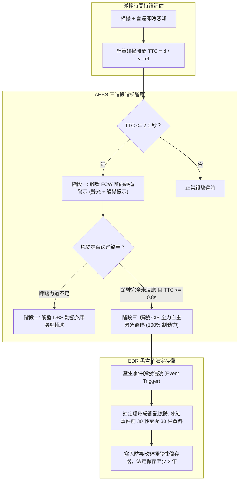

# 第 8 章：自動煞車、安全與未來應用

---

## 1. 本章學習目標

* **掌握 AEBS 主動安全運作機制與國際測試標準**：依據財團法人車輛研究測試中心（ARTC）技術專文 `[自動緊急煞車性能評估.pdf，第 1～2 頁（PDF 第 1～2 頁）]`，掌握先進自動緊急煞車系統（AEBS）之階梯式預警介入機制、ISO 22733 測試法規、RTK-DGPS 差分定位與機器人自動化評估平台。
* **精通 Mobileye 責任敏感安全模型（RSS）概念與數學原理**：依據交通部運輸研究所研究報告之分析 `[SAE J3016.pdf，印刷第 26～27 頁（PDF 第 36～37 頁，圖 3.9）]`，掌握 RSS 五大安全原則與 25 項安全定義概念；並依據 Mobileye 2017 原著論文掌握縱向/橫向最小安全防禦距離公式推導及其在自駕責任邊界界定中的核心角色 `[通用工程理論補充 / 依據 Mobileye 2017 原著論文補充]`。
* **掌握事件資料紀錄器（EDR / 黑盒子）法規要件與草案建議**：掌握德國道路交通法（StVG）修正案與新加坡自駕測試規定中對黑盒子的法定要求 `[SAE J3016.pdf，印刷第 40, 123 頁（PDF 第 50, 133 頁）]`，以及交通部運輸研究所研究案提出之法規草案建議中**觸發事件前後 30 秒行車數據保存至少 3 年**的規範 `[SAE J3016.pdf，印刷第 82 頁（PDF 第 92 頁，表 6-2）]`（特別注意：此為研究團隊提出之法規架構建議版本，並非台灣現行已生效之法律）。
* **前瞻自動駕駛長遠演進趨勢**：剖析自駕車面臨之長尾效應（Long-tail Problem）、車聯網協同感知（V2X）與端到端神經網路（End-to-End Autonomous Driving）的未來技術邊界。

---

## 2. 章節簡介

在自動駕駛系統的全部工程拼圖中，「安全」永遠是不可踰越的第一準則。無論感知多麼敏銳、路徑規劃多麼流暢，若無法在遭遇突發碰撞危機時穩健避險，自駕車就永遠無法取得公眾信任與法規核准。

本章結合 ARTC 的檢測驗證技術報告與交通部運輸研究所的法規研究，深入剖析守護車輛主動安全的最重要底線——**先進自動緊急煞車系統（AEBS）**與國際標準 **ISO 22733** 之實車測試驗證。接著，探討 Mobileye 如何透過嚴謹的**責任敏感安全模型（RSS）**將「人類防禦駕駛智慧」轉化為精確的幾何與微積分公式，為自駕車構建不可侵犯的安全氣泡；最後解析**事件資料紀錄器（EDR）**在事故調查與法律歸責中的關鍵作用，並展望無人駕駛技術的未來演進。

---

## 3. 詳細技術小節

### 3.1 自動緊急煞車系統（AEBS）性能評估與國際標準

自動緊急煞車系統（AEBS, Advanced Emergency Braking System）是近代汽車主動安全防護的里程碑技術，也是 L0～L5 自駕車輛不可或缺的底層安全保險 `[自動緊急煞車性能評估.pdf，第 1 頁（PDF 第 1 頁）]`：

#### 3.1.1 AEBS 階梯式響應時序
系統透過毫米波雷達與前向攝影機持續計算目標之**碰撞時間（TTC, Time to Collision）**：
1. **前方碰撞預警（FCW, Forward Collision Warning）**：在碰撞前約 1.8～2.0 秒，透過抬頭顯示儀表閃爍紅光、座艙警示蜂鳴聲或安全帶預收緊提醒人類駕駛主動制動。
2. **動態煞車輔助（DBS, Dynamic Brake Support）**：若駕駛員已踩下煞車但踏板力道不足，系統主動增壓補足最大制動液壓。
3. **碰撞緩解/緊急煞停（CIB, Crash Imminent Braking）**：在碰撞前約 0.8～1.0 秒，若駕駛毫無反應且碰撞已不可避免，系統繞過駕駛意圖，命令線控液壓機構爆發 100% 最大煞車減速度（通常高達 $0.8g \sim 1.0g$），以求在碰撞前完全煞停，或最大限度吸收衝擊動能。

#### 3.1.2 國際測試標準 ISO 22733 與測試規範
* **ISO 22733**：乘用車自動緊急煞車系統性能評估國際標準，涵蓋車對車（Car-to-Car）靜止、慢速移動與煞車減速多種工況。
* **高精測試裝備架構** `[自動緊急煞車性能評估.pdf，第 1～2 頁（PDF 第 1～2 頁）]`：
  * **RTK-DGPS（即時動態差分 GPS）**：提供釐米級（$< 2 \text{ cm}$）受測車與目標物之即時空間相對位置、車速與偏航角數據。
  * **方向盤與煞車控制機器人**：安裝於受測車內，精確消除人類駕駛操作踏板之時間延遲與踩踏力道誤差，保證測試工況之高重複性。
  * **軟式目標車（GVT, Global Vehicle Target）**：依據國際標準製作之可承受高速撞擊而不損壞受測車的碳纖維與發泡材料仿真車輛。
* **弱勢道路使用者測試（VRU, Vulnerable Road Users）**：
  * 依據 **ISO 19206-2（行人目標）** 與 **ISO 19206-3（自行車目標）**，利用同步滑軌系統牽引成人假人、兒童假人（模擬視線遮蔽處突發衝出）以及軟式自行車橫越車道，評估車載視覺與雷達對人體微弱特徵之識別與緊急制動反應 `[自動緊急煞車性能評估.pdf，第 1 頁（PDF 第 1 頁）]`。

---

### 3.2 責任敏感安全模型（Mobileye RSS）之數學與哲學框架

雖然機器學習在感知領域取得了巨大成功，但神經網路本質是機率黑盒子，無法提供 100% 的安全數學保證。Mobileye 提出 **RSS（Responsibility-Sensitive Safety，責任敏感安全模型）**，旨在以確定性的數學不等式界定防禦駕駛邊界 `[SAE J3016.pdf，印刷第 26～27 頁（PDF 第 36～37 頁，圖 3.9）]`：

#### 3.2.1 RSS 五項核心常識安全原則
1. **規則一（絕不追撞前車）**：在後方跟隨時，必須保持充分之縱向安全距離，即使前車以物理極限緊急煞停，後車也能安全停下。
2. **規則二（絕不魯莽切入）**：變換車道或切入相鄰車道時，絕不可迫使後方車輛採取非正常的劇烈煞車或緊急轉向。
3. **規則三（尊重路權優先順序）**：在無號誌十字路口或路權衝突情境下，必須嚴格遵守路權分配，不得強行搶道。
4. **規則四（防範視野盲區風險）**：在行經視線受遮蔽之建築轉角或停泊大貨車側方時，車輛必須採取謹慎車速（Cautious Speed）行駛，預留對盲區突然衝出目標之安全反應時間。
5. **規則五（積極避讓責任）**：即使自駕車完全擁有路權，若他車發生違規且自駕車具備物理避險能力，自駕車必須主動採取避讓動作，絕不可機械式主張路權而導致車禍發生。

#### 3.2.2 縱向最小安全防禦距離數學推導
在跟隨前車行駛時，兩車縱向間距 $d$ 必須始終大於最小安全防禦距離 $d_{min}$（運研所報告第 26～27 頁記載 RSS 具備數學公式與 25 項定義；具體微積分展開公式出自 Mobileye 2017 原著論文 *On a Formal Model of Safe and Scalable Self-driving Cars* `[通用工程理論補充 / 依據 Mobileye 2017 論文補充]`）：

$$d_{min} = \left[ v_r \cdot \rho + \frac{1}{2} a_{max,accel} \cdot \rho^2 + \frac{(v_r + \rho \cdot a_{max,accel})^2}{2 a_{min,brake}} - \frac{v_f^2}{2 a_{max,brake}} \right]^+$$

* **變數物理意義與工程解釋**：
  * $v_r$：後方跟隨車輛（自駕車自身）之當前行駛車速。
  * $v_f$：前方行駛車輛之當前車速。
  * $\rho$（Rho）：自駕系統之最壞情況反應時間（包含感測推論延遲、控制通訊延遲以及液壓煞車油路建壓響應延遲，通常設為 0.5～1.0 秒）。
  * $a_{max,accel}$：後車在反應時間 $\rho$ 內可能持續採取的最大加速度（預防油門誤踩）。
  * $a_{min,brake}$：後車在啟動緊急煞車時保證可施加之最小減速度（保守制動能力）。
  * $a_{max,brake}$：前車在物理附著力極限下可能爆發之最大制動減速度。
  * $[x]^+ = \max(x, 0)$：保證距離值非負。
* **數學物理意涵**：即使前車以不可思議的極限減速度全力煞死，自駕車在經過反應時間延遲後以保底減速度煞車，兩車的停止距離差距仍永遠大於零。只要自駕車始終維持 $d > d_{min}$，則在任何追撞事故中自駕車在法律與物理上均無過失。

---

### 3.3 自駕車事件資料紀錄器（EDR / Black Box）與法規監管

當自駕車由 L2 邁入 L3/L4 時，事故歸責成為司法制度面臨的終極挑戰。各國自駕法規均將車載資料記錄器列為準入道路測試的強制法定條件 `[SAE J3016.pdf，印刷第 40, 54, 82, 123 頁（PDF 第 50, 64, 92, 133 頁）]`：

#### 3.3.1 德國道路交通法（StVG）修正案與跨國規範
* **控制權切換鐵證**：德國聯邦法律明確要求，自駕車輛必須裝載黑盒子，記錄「自動駕駛模式啟動瞬間」、「駕駛人接管車輛瞬間」、「系統發出 TOR 接管請求瞬間」之精確時間戳記（Timestamp），作為事故時責任歸屬於系統（車廠）或駕駛人的法定依據 `[SAE J3016.pdf，印刷第 40 頁（PDF 第 50 頁）]`。
* **新加坡自駕規範**：要求自駕測試必須具備防篡改數據鏈路，向主管機關實時或事後呈報行車記錄 `[SAE J3016.pdf，印刷第 123 頁（PDF 第 133 頁）]`。

#### 3.3.2 事故數據保存法定規範（台灣與國際趨勢）
依據交通部運輸研究所綜合各國測試規範之研議 `[SAE J3016.pdf，印刷第 82 頁（PDF 第 92 頁，表 6-2）]`：
* **關鍵觸發時窗**：當車輛發生氣囊爆發、AEB 全力觸發或偵測到重大加速度衝擊（G 值突變）時，EDR 必須立即鎖定**觸發事件前 30 秒至觸發事件後 30 秒（共計 60 秒）**的高頻原始工程數據。
* **法定保存期限**：事故鎖定數據必須於車載防篡改非揮發性記憶體中**妥善保存至少 3 年**，以備司法與事故鑑定委員會調閱調查。
* **法定必錄欄位**：
  1. 動態駕駛任務控制者標記（人類 / 系統）。
  2. 橫縱向運動狀態（實測車速、縱向與橫向加速度、偏航角速度）。
  3. 駕駛人輸入（方向盤轉角、煞車踏板行程、油門開度、安全帶扣合狀態）。
  4. 感測器健康狀態與報警日誌。

---

### 3.4 自動駕駛未來展望與技術邊界

1. **車路協同與車聯網（V2X, Vehicle-to-Everything）**：
   * 透過 5G-V2X / C-V2X 技術，自駕車不僅仰賴自體感測器（單車智能），還能接收路側單元（RSU）、紅綠燈倒數秒數以及對向車輛傳來的「超視距感知資訊」，徹底消除視線死角盲區 `[自駕車暨先進駕駛輔助系統技術.pdf，印刷第 1～3 頁（PDF 第 1～3 頁）]`。
2. **長尾極端工況（Long-tail Edge Cases）**：
   * 自駕系統在 99% 的一般路況下表現完美，但剩下的 1% 長尾問題（如狂風吹落的巨大床墊、道路施工人員奇怪的手勢引導、穿著奇裝異服的街頭表演者）仍是規則型演算法與傳統卷積網路難以攻克的瓶頸。
3. **端到端大模型（End-to-End Autonomous Driving）演進趨勢**：
   * 當前主流分層模組（感知 $\rightarrow$ 預測 $\rightarrow$ 規劃）存在模組間資訊有損傳遞的問題。未來正朝向以多模態大模型為核心的「端到端」架構演進，直接輸入全景相機與光達原始串流，端到端輸出未來軌跡與控制指令，成為自駕 AI 研究之最前沿。

---

## 4. 核心技術名詞及繁體中文解釋

| 英文專有名詞 | 縮寫 | 繁體中文名詞 | 核心定義與解釋 |
| :--- | :--- | :--- | :--- |
| **Advanced Emergency Braking System** | AEBS | 先進自動緊急煞車系統 | 透過雷達與相機監控前向碰撞風險，在駕駛未及時反應時自主爆發全力制動之主動安全系統。 |
| **Responsibility-Sensitive Safety** | RSS | 責任敏感安全模型 | Mobileye 提出之形式化數學模型，將防禦駕駛概念嚴格定義為幾何安全邊界，量化行車安全責任。 |
| **Event Data Recorder** | EDR | 事件資料紀錄器 / 車載黑盒子 | 專門在車輛碰撞或極端事件觸發時，高頻記錄關鍵行車狀態與操控模式之法定防篡改數據存儲模組。 |
| **Vulnerable Road Users** | VRU | 弱勢道路使用者 | 在交通環境中缺乏金屬車殼保護之行人、自行車騎士與輪椅使用者，在主動安全測試中具備嚴格標準。 |
| **Time to Collision** | TTC | 碰撞前剩餘時間 | 當前相對距離除以相對接近速度（$TTC = \Delta d / \Delta v$），為觸發警示與自動煞停的核心時間門檻。 |

---

## 5. 重要原理與技術運作流程

AEBS 階梯式觸發機制與 EDR 數據封存流程如下 `[自動緊急煞車性能評估.pdf，第 1 頁（PDF 第 1 頁）]` 與 `[SAE J3016.pdf，印刷第 82 頁（PDF 第 92 頁，表 6-2）]`：

---

## 6. 實際應用案例

### 6.1 ARTC 國際法規級 AEB 實車評估測試
* **測試現場還原**：在彰化鹿港車輛研究測試中心（ARTC）封閉試驗場中 `[自動緊急煞車性能評估.pdf，第 1～2 頁（PDF 第 1～2 頁）]`，受測車輛以時速 50 km/h 巡航逼近靜止之軟式目標車（GVT）。受測車之自動煞車演算法在 TTC 達 1.6 秒時發出蜂鳴警示；在 TTC 降至 0.8 秒時，車載機器人感測到底盤線控系統自主建壓爆發 $-0.9g$ 之強大減速度，受測車最終在距離目標車 0.8 公尺處穩穩煞停，成功達成零碰撞驗證。

---

## 7. 優點、缺點與技術限制

| 安全架構 | 核心優點 | 主要工程挑戰與技術限制 |
| :--- | :--- | :--- |
| **AEBS 主動安全** | 能在人類分心或疲勞駕駛的最後關頭自主介入，顯著降低 50% 以上之後向追撞事故與傷亡。 | **幽靈煞車（Phantom Braking）風險**：在高速公路遇到金屬高架路標或反光水灘時，若感測器誤判前方存在障礙物而突然急煞，極易造成後方來車嚴重追撞。 |
| **Mobileye RSS 模型** | 以確定性數學不等式構建無可置疑的法律免責邊界，為自駕車上路提供理論安全證明。 | 數學公式高度依賴輪胎與地面摩擦係數等物理假設；若道路遭遇結冰或油漬，實際摩擦力遠低於模型設定值時，防禦距離將失效。 |
| **EDR 黑盒子存儲** | 為法官、保險公司與監管機關提供客觀不可竄改的事故還原鐵證，杜絕推卸責任。 | 高頻資料（如影像、點雲）寫入頻寬與車載儲存晶片成本的權衡；駕駛人隱私保護（GDPR）與資料開放之爭議。 |

---

## 8. 圖解建議

1. **ISO 22733 測試跑道佈局立體圖**：展示受測自駕車、RTK-DGPS 基站、假人牽引滑軌架、軟式目標車（GVT）以及雙方行進軌跡向量之全景測試示意圖 `[參考 自動緊急煞車性能評估.pdf 第 1 頁]`。
2. **RSS 安全氣泡幾何走廊圖**：以俯視視角繪製自駕車前進方向的綠色安全行駛走廊，展示前車後方以 $d_{min}$ 劃出之紅色「禁區邊界」，生動解釋不可侵犯安全走廊概念 `[參考 SAE J3016.pdf 圖 3.9]`。

---

## 9. 專有名詞彙整表

| 名詞 | 英文全名 | 中文解釋 |
| :--- | :--- | :--- |
| **CIB** | Crash Imminent Braking | 碰撞迫近緊急煞停，AEBS 系統在碰撞無法避免時由電腦完全自主執行的最大制動煞車。 |
| **GVT** | Global Vehicle Target | 全球標準軟式目標車，符合 ISO 國際規範、具備真實車輛雷達反射與光學外觀但碰撞時不會損壞車輛之測試假車。 |
| **V2X** | Vehicle-to-Everything | 車聯網通訊技術，涵蓋車對車（V2V）、車對基礎設施（V2I）與車對行人（V2P）之高速無線資料交互。 |
| **Safety Bubble** | Safety Bubble | 安全氣泡，自駕車周遭依據車速、物理制動極限與系統反應時間所計算出的不可侵入虛擬幾何防護區間。 |

---

## 10. 本章重點整理

1. **AEBS 系統**透過 FCW、DBS 與 CIB 三階段響應，結合 **ISO 22733** 嚴苛測試，是守護車輛主動安全的最後物理防線。
2. **Mobileye RSS 模型**將防禦駕駛轉化為精確的**縱向與橫向最小安全距離數學公式**，從理論上確保自駕車「永不主動引發事故」。
3. **自駕車 EDR（黑盒子）法規**明確要求鎖定**事件前後 30 秒高頻數據並法定保存至少 3 年**，是釐清人機操控責任與推動法規演進的法律基石。
4. 未來自動駕駛的終極突破將仰賴**單車智能與 V2X 車路協同**的結合，並向處理長尾極端工況的**端到端大模型**深度演進。
